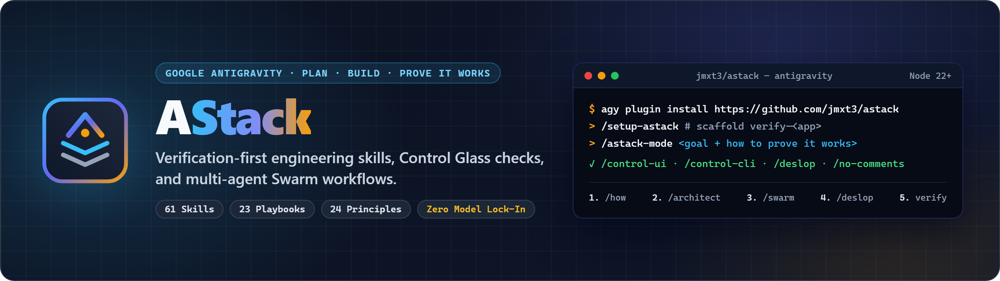

# AStack — Verification-first engineering skills & multi-agent workflows for Google Antigravity

<p align="center">
  <picture>
    <source media="(prefers-color-scheme: light)" srcset="./assets/banner-light.png">
    
  </picture>
</p>

<p align="center">
  <a href="https://github.com/jmxt3/astack/actions/workflows/ci.yml"></a>
  <a href="./plugin.json"></a>
  <a href="https://antigravity.google"></a>
  <a href="https://nodejs.org">= 22.6"></a>
  <a href="https://www.typescriptlang.org"></a>
  <a href="./LICENSE"></a>
</p>

**AStack** (`astack`) is a native **Google Antigravity** plugin bundling **61 skills**, **23 playbooks**, **24 engineering principles**, **2 custom agents**, **1 orchestration rule**, and **2 opt-in lifecycle hooks**. State the outcome you want and how to verify it works, and `/astack-mode` selects the matching playbook, coordinates Antigravity's subagents and multi-agent modes, cleans the diff, and proves behavior against the running UI or CLI before reporting done.

**Local-first, with zero model lock-in.** AStack installs as static markdown skills and local Node.js 22+ scripts with no hosted backend, no telemetry, and no model-pinning config. It inherits whatever model or plan you already run in Antigravity (including `Orchestrator` where supported). Adapted and engineered for Google Antigravity by **João Machete** ([`jmxt3/astack`](https://github.com/jmxt3/astack)) from **Lauren Tan (`@poteto`)**'s [`pstack`](https://github.com/cursor/plugins/tree/main/pstack) (MIT License, baseline `v0.15.36`).

<p align="center">
  <a href="#install">Install</a> ·
  <a href="#quick-start">Quick start</a> ·
  <a href="./docs/user-guide.md">User guide</a> ·
  <a href="./docs/guide/README.md">10-part tutorial</a> ·
  <a href="./docs/architecture-and-swarm.md">Architecture &amp; Swarm</a> ·
  <a href="#documentation">Documentation</a> ·
  <a href="#skill-catalog">61 skills</a> ·
  <a href="./CONTRIBUTING.md">Contributing</a> ·
  <a href="./SECURITY.md">Security</a>
</p>

## Feature highlights

- **Goal-driven playbook routing**: [`/astack-mode`](./skills/astack-mode/SKILL.md) matches your request to 23 engineering playbooks (`bug-fix`, `feature`, `refactoring`, `perf-issue`, `babysit`, `shipping`, and more), while [`/astack-help`](./skills/astack-help/SKILL.md) recommends the right skill and copy-paste prompt without running execution work.
- **Live UI and CLI verification ("Control Glass")**: [`/control-ui`](./skills/control-ui/SKILL.md) drives live web and Electron apps through Antigravity's `browser` subagent and Chrome DevTools MCP, [`/control-cli`](./skills/control-cli/SKILL.md) tests CLIs and daemons in isolated temp directories, and [`/create-verification-skill`](./skills/create-verification-skill/SKILL.md) generates repo-local `.agents/skills/verify-<app>/` feature maps.
- **Native Antigravity multi-agent integration**: Pairs AStack playbooks with `invoke_subagent` ([`/fanout`](./skills/fanout/SKILL.md)), `/boost` (hard coupled bugs), `/swarm` (board-coordinated parallel writers and `@verifier` gates), `/teamwork` (multi-milestone efforts), and `/goal` + `/schedule` (overnight runs with `decisions.tsv`).
- **Parallel design and formal checks**: [`/architect`](./skills/architect/SKILL.md) explores competing cross-boundary designs, [`/arena`](./skills/arena/SKILL.md) runs isolated multi-candidate bakeoffs and grafts winning pieces, [`/interrogate`](./skills/interrogate/SKILL.md) challenges assumptions with diverse reviewers, and [`/statechart`](./skills/statechart/SKILL.md) turns TLA+ / TLC checks into Mermaid statecharts.
- **Automated code, comment, and prose cleanup**: [`/deslop`](./skills/deslop/SKILL.md) strips dead wrappers and unsupported fallbacks, [`/no-comments`](./skills/no-comments/SKILL.md) runs [`comment-sicko`](./agents/comment-sicko.md) to delete narrating comments and flag workarounds, and [`/unslop`](./skills/unslop/SKILL.md) + [`/technical-writing`](./skills/technical-writing/SKILL.md) tighten docs and PR descriptions.
- **Cross-platform Node.js 22+ runtime**: Every bundled CLI (`statechart.mjs`, `watch-pr`, `worktree-audit`, `log.mjs`, hooks, sync, and validation) runs natively on Windows, macOS, and Linux with no Bun requirement.

## Install

Requires **Google Antigravity** and **Node.js `>= 22.6`** (`22.18+` or `23.6+` for unflagged TypeScript type stripping). Install **Java** only if you run live TLC model checking through `/statechart`.

Install directly from GitHub and verify plugin registration:

```bash
agy plugin install https://github.com/jmxt3/astack
agy plugin list --json
```

To install from a local clone instead, run `agy plugin install ./astack` (or `agy plugin install .` inside the repository). On Windows, if updating while Antigravity is running fails with `Access is denied`, run `agy plugin uninstall astack` first and reinstall.

## Quick start

1. **Initialize verification in your repository once** by running `/setup-astack` inside Antigravity and choosing **`(Recommended)`**. It inspects your project and scaffolds a repo-specific `.agents/skills/verify-<app>/` skill so future runs know how to start and verify your app.
2. **Run a task with `/astack-mode`** by stating what you want and how to check it works:

   ```text
   /astack-mode add a --json flag to the export command. keep plain text output byte-identical, prove both outputs on the sample fixture, and don't push yet.
   ```

3. **Ask `/astack-help` when unsure** to get a recommended skill, reasoning, and ready-to-send prompt before spending execution turns:

   ```text
   /astack-help which skill should I use to review this branch before opening a PR?
   ```

## How it fits together

Most work flows through five stages. You do not need to chain commands manually because `/astack-mode` calls them when needed, though you can invoke any stage directly:

```text
1. Understand (/how, /why, /teach, /recall)
   -> 2. Design (/architect, /arena, /interrogate)
   -> 3. Build (/astack-mode playbooks + /tdd)
   -> 4. Clean (/deslop, /no-comments, /unslop)
   -> 5. Verify & ship (/control-ui, /control-cli, verify-<app>, /blast-radius)
```

[`rules/astack-orchestration.md`](./rules/astack-orchestration.md) also guides model-decision routing across Antigravity's native execution modes (explained in full in [`docs/architecture-and-swarm.md`](./docs/architecture-and-swarm.md)):

| Execution mode | Choose when | Key AStack pairing |
|---|---|---|
| **Subagents** (`invoke_subagent`, [`/fanout`](./skills/fanout/SKILL.md)) | Self-contained research, browser checks, test slices, or declared races | [`/how`](./skills/how/SKILL.md), [`/why`](./skills/why/SKILL.md), [`/fanout`](./skills/fanout/SKILL.md), [`/arena`](./skills/arena/SKILL.md), [`/interrogate`](./skills/interrogate/SKILL.md) |
| **`/boost`** | Problem is hard rather than broad (races, coupled refactors, deep perf or bugs) | `bug-fix`, `perf-issue`, `hillclimb`, [`/tdd`](./skills/tdd/SKILL.md), [`/statechart`](./skills/statechart/SKILL.md) |
| **`/swarm`** | Work is broad and divides cleanly across files, packages, or test suites | Shared board, isolated `workspace: "share"` or `"branch"` writers, `@verifier` + `@monitor` |
| **`/teamwork`** | Long-horizon, multi-milestone migrations, rewrites, or formal efforts | Scoping interview and milestone gates with [`/architect`](./skills/architect/SKILL.md) and [`/show-me-your-work`](./skills/show-me-your-work/SKILL.md) |
| **`/goal`** (+ **`/schedule`**) | Overnight or autonomous iteration toward a checkable finish predicate | `autonomous-run`, [`/figure-it-out`](./skills/figure-it-out/SKILL.md), `decisions.tsv`, [`/ketchup`](./skills/ketchup/SKILL.md) |

> **Why `/fanout` instead of `skills/swarm`?** Antigravity gives built-in skills higher priority than plugin skills of the same name. AStack renames upstream `skills/swarm` to [`skills/fanout`](./skills/fanout/SKILL.md) so Antigravity's native `/swarm` multi-agent board is never shadowed.

## Skill catalog

AStack ships **61 skills** (`skills/`), **2 agents** (`agents/`), **1 routing rule** (`rules/`), and **2 opt-in hooks** (`hooks.json`):

### Orchestration & setup (3)

| Skill | Purpose |
|---|---|
| [`/astack-mode`](./skills/astack-mode/SKILL.md) | Main entry point routing tasks across 23 playbooks, 24 principles, subagents, and Antigravity multi-agent modes |
| [`/astack-help`](./skills/astack-help/SKILL.md) | Recommends the right skill and gives a copy-paste prompt without spending execution turns |
| [`/setup-astack`](./skills/setup-astack/SKILL.md) | Scaffolds repo-local `verify-<app>` verification skills and optional formal verification |

<details>
<summary>23 playbooks inside /astack-mode (skills/astack-mode/playbooks/)</summary>

| Playbook | When `/astack-mode` uses it |
|---|---|
| [`authoring-a-skill.md`](./skills/astack-mode/playbooks/authoring-a-skill.md) | Creating or editing an Antigravity `SKILL.md` under 24,000 bytes |
| [`autonomous-run.md`](./skills/astack-mode/playbooks/autonomous-run.md) | Driving unattended `/goal` tasks toward a checkable finish predicate |
| [`autopilot-full.md`](./skills/astack-mode/playbooks/autopilot-full.md) | Swarm-verified multi-PR execution with independent verification before merge |
| [`autopilot-stack.md`](./skills/astack-mode/playbooks/autopilot-stack.md) | Building and verifying a stacked PR sequence without merging |
| [`babysit.md`](./skills/astack-mode/playbooks/babysit.md) | Driving open PRs to green checks and resolving review threads |
| [`bug-fix.md`](./skills/astack-mode/playbooks/bug-fix.md) | Reproducing a bug live first, tracing root cause, and verifying the fix |
| [`eval.md`](./skills/astack-mode/playbooks/eval.md) | Designing, blinding, running, and synthesizing controlled experiments |
| [`feature.md`](./skills/astack-mode/playbooks/feature.md) | Domain-first feature implementation with boundary checks and verification |
| [`hillclimb.md`](./skills/astack-mode/playbooks/hillclimb.md) | Iterating repeatedly on one measurable metric against a target |
| [`investigation.md`](./skills/astack-mode/playbooks/investigation.md) | Read-only evidence gathering and cited diagnosis without editing code |
| [`multi-phase-plan.md`](./skills/astack-mode/playbooks/multi-phase-plan.md) | Writing a verifiable multi-phase or multi-PR execution checklist |
| [`opening-a-pr.md`](./skills/astack-mode/playbooks/opening-a-pr.md) | Packaging a clean, verified diff and concise PR summary |
| [`orchestrate.md`](./skills/astack-mode/playbooks/orchestrate.md) | Multi-day coordinator loop across Swarm workers and milestone gates |
| [`pause-safely.md`](./skills/astack-mode/playbooks/pause-safely.md) | Leaving an explicit checkpoint for cold-start resumption on interruption |
| [`perf-issue.md`](./skills/astack-mode/playbooks/perf-issue.md) | Profiling bottlenecks and vetting before/after latency or throughput claims |
| [`prototype.md`](./skills/astack-mode/playbooks/prototype.md) | Running throwaway empirical prototypes to settle design or UI questions |
| [`refactoring.md`](./skills/astack-mode/playbooks/refactoring.md) | Changing internal structure while proving identical observable behavior |
| [`runtime-forensics.md`](./skills/astack-mode/playbooks/runtime-forensics.md) | Instrumenting live processes for runtime diagnosis instead of guessing |
| [`session-pickup.md`](./skills/astack-mode/playbooks/session-pickup.md) | Resuming interrupted work from decision trails and repository state |
| [`shipping.md`](./skills/astack-mode/playbooks/shipping.md) | Landing a verified PR stack sequentially after independent verification |
| [`trace-forensics.md`](./skills/astack-mode/playbooks/trace-forensics.md) | Diagnosing failures directly from captured trace artifacts and logs |
| [`visual-parity.md`](./skills/astack-mode/playbooks/visual-parity.md) | Pixel-exact UI comparison verified via automated image diffs |
| [`worktree-cleanup.md`](./skills/astack-mode/playbooks/worktree-cleanup.md) | Auditing and cleaning merged or stale git worktrees with `worktree-audit.mjs` |

</details>

### Understanding & recall (5)

| Skill | Purpose |
|---|---|
| [`/how`](./skills/how/SKILL.md) | Explains subsystem architecture, runtime flow, ownership, and layering before edits |
| [`/why`](./skills/why/SKILL.md) | Investigates why code or rules exist using git history, PRs, and connected MCP sources |
| [`/teach`](./skills/teach/SKILL.md) | Combines `/how` and `/why` into a plain-language explanation of a subsystem or PR |
| [`/recall`](./skills/recall/SKILL.md) | Mines recent Antigravity transcripts and live repo or PR state across sessions |
| [`/in-your-own-words`](./skills/in-your-own-words/SKILL.md) | Restates the user's goal and underlying problem before starting work |

### Design & parallel exploration (6)

| Skill | Purpose |
|---|---|
| [`/architect`](./skills/architect/SKILL.md) | Explores competing architectures in parallel, checks design red flags, and writes a type sketch |
| [`/arena`](./skills/arena/SKILL.md) | Runs 2 to 3 isolated candidate implementations against the same check and grafts winning pieces |
| [`/fanout`](./skills/fanout/SKILL.md) | Fans out independent read-only sweeps, test matrices, or file-disjoint tasks to subagents |
| [`/interrogate`](./skills/interrogate/SKILL.md) | Stress-tests plans and diffs with adversarial review backed by empirical reproduction |
| [`/sharpen`](./skills/sharpen/SKILL.md) | Refines a task to be deeper rather than broader and rewrites the prompt |
| [`/figure-it-out`](./skills/figure-it-out/SKILL.md) | Designs an auditable hypothesis loop for open-ended migrations and multi-part changes |

### Verification & formal checks (11)

| Skill | Purpose |
|---|---|
| [`/control-ui`](./skills/control-ui/SKILL.md) | Verifies live web and Electron UIs via `browser` subagent and Chrome DevTools MCP |
| [`/control-cli`](./skills/control-cli/SKILL.md) | Verifies CLIs, daemons, and HTTP or RPC services against temp workspaces, exit codes, and cleanup |
| [`/create-verification-skill`](./skills/create-verification-skill/SKILL.md) | Generates a repo-local `verify-<app>` skill and `features/` sitemap |
| [`/maintain-verification-skill`](./skills/maintain-verification-skill/SKILL.md) | Audits and updates a project's `verify-<app>` skill against current code and live UI or CLI flows |
| [`/create-formal-verification-skill`](./skills/create-formal-verification-skill/SKILL.md) | Scaffolds TLA+ formal specification checks for stateful protocols and concurrency invariants |
| [`/maintain-formal-verification-skill`](./skills/maintain-formal-verification-skill/SKILL.md) | Audits existing TLA+ models and specs against code changes |
| [`/statechart`](./skills/statechart/SKILL.md) | Runs TLA+ / TLC checks (`statechart.mjs`) and outputs Mermaid statecharts plus shortest failing paths |
| [`/benchmark-checklist`](./skills/benchmark-checklist/SKILL.md) | Vets measured latency, throughput, and speedup numbers before reporting results |
| [`/blast-radius`](./skills/blast-radius/SKILL.md) | Finds non-local callers or invariants a small diff could break and proves safety with real execution |
| [`/tdd`](./skills/tdd/SKILL.md) | Drives cheap local failing-test-first loops when explicitly requested or clearly bounded |
| [`/show-me-your-work`](./skills/show-me-your-work/SKILL.md) | Records structured decision logs (`decisions.tsv`) and receipts for long autonomous runs |

### Code, prose & workflow hygiene (6)

| Skill | Purpose |
|---|---|
| [`/deslop`](./skills/deslop/SKILL.md) | Pre-commit cleanup stripping single-caller helpers, dead compatibility shims, and unrelated edits |
| [`/no-comments`](./skills/no-comments/SKILL.md) | Spawns `comment-sicko` to delete narrating comments and encode real constraints in types or lints |
| [`/unslop`](./skills/unslop/SKILL.md) | Removes AI phrasing tells, filler words, and mannered prose from docs and replies |
| [`/technical-writing`](./skills/technical-writing/SKILL.md) | Layered writing standard (Diátaxis, Google developer style, STE rules, Global English) |
| [`/typescript-best-practices`](./skills/typescript-best-practices/SKILL.md) | TypeScript patterns for discriminated unions, boundary parsing, and exhaustive matching |
| [`/correct`](./skills/correct/SKILL.md) | Pushes recurring mistakes up the stack into architecture, types, lints, or tests |

### Session catch-up, reflection & automation (6)

| Skill | Purpose |
|---|---|
| [`/ketchup`](./skills/ketchup/SKILL.md) | Plain-language summary of what changed since your last message plus decisions waiting on you |
| [`/ketchup-video`](./skills/ketchup-video/SKILL.md) | Renders a short subtitled slide video catch-up with pending decisions underneath |
| [`/reflect`](./skills/reflect/SKILL.md) | Reviews the active transcript with three parallel reviewers and turns lessons into skill edits |
| [`/automate-me`](./skills/automate-me/SKILL.md) | Turns your recurring working conventions into a personal `-mode` skill |
| [`/make-bot-ui`](./skills/make-bot-ui/SKILL.md) | Builds safe webhook-backed UI triggers and Tailscale setups for Antigravity automations |
| [`/bro`](./skills/bro/SKILL.md) | Restates the last agent response in plain human language with no jargon |

<details>
<summary>24 engineering principles (surfaced and cited automatically by /astack-mode)</summary>

| Principle | Group | Decision rule |
|---|---|---|
| [`principle-laziness-protocol`](./skills/principle-laziness-protocol/SKILL.md) | Core | Bias toward deletion and the smallest sound change |
| [`principle-foundational-thinking`](./skills/principle-foundational-thinking/SKILL.md) | Core | Get core types and data structures right before writing logic |
| [`principle-redesign-from-first-principles`](./skills/principle-redesign-from-first-principles/SKILL.md) | Core | Redesign structure cleanly instead of bolting patches onto old assumptions |
| [`principle-attack-the-premise`](./skills/principle-attack-the-premise/SKILL.md) | Core | Test the shared premise directly after two failed fixes hit the same gate |
| [`principle-subtract-before-you-add`](./skills/principle-subtract-before-you-add/SKILL.md) | Core | Remove dead code and redundant checks before building new behavior |
| [`principle-minimize-reader-load`](./skills/principle-minimize-reader-load/SKILL.md) | Core | Collapse one-caller wrappers and shrink mutable scope |
| [`principle-outcome-oriented-execution`](./skills/principle-outcome-oriented-execution/SKILL.md) | Core | Converge to the target design during migrations instead of keeping shims |
| [`principle-experience-first`](./skills/principle-experience-first/SKILL.md) | Core | Choose user experience over implementation convenience |
| [`principle-exhaust-the-design-space`](./skills/principle-exhaust-the-design-space/SKILL.md) | Core | Compare 2 to 3 prototypes side by side for novel interactions or designs |
| [`principle-build-the-lever`](./skills/principle-build-the-lever/SKILL.md) | Core | Build repeatable verification or migration scripts instead of editing by hand |
| [`principle-model-the-domain`](./skills/principle-model-the-domain/SKILL.md) | Architecture | Replace scattered conditionals with explicit tables or state machines |
| [`principle-boundary-discipline`](./skills/principle-boundary-discipline/SKILL.md) | Architecture | Validate untrusted inputs at boundaries and keep core functions pure |
| [`principle-type-system-discipline`](./skills/principle-type-system-discipline/SKILL.md) | Architecture | Make illegal states unrepresentable and parse external payloads once |
| [`principle-make-operations-idempotent`](./skills/principle-make-operations-idempotent/SKILL.md) | Architecture | Ensure commands and loops converge to the same state across retries |
| [`principle-migrate-callers-then-delete-legacy-apis`](./skills/principle-migrate-callers-then-delete-legacy-apis/SKILL.md) | Architecture | Migrate all callers and remove old internal APIs in one wave |
| [`principle-separate-before-serializing-shared-state`](./skills/principle-separate-before-serializing-shared-state/SKILL.md) | Architecture | Isolate concurrent writers in separate workspaces before locking shared state |
| [`principle-prove-it-works`](./skills/principle-prove-it-works/SKILL.md) | Verification | Prove behavior on the running surface rather than relying on mocks or builds |
| [`principle-fix-root-causes`](./skills/principle-fix-root-causes/SKILL.md) | Verification | Fix the earliest broken invariant instead of masking invalid state |
| [`principle-sequence-verifiable-units`](./skills/principle-sequence-verifiable-units/SKILL.md) | Verification | Break large changes into units that each end in an empirical check |
| [`principle-test-behavior-not-implementation`](./skills/principle-test-behavior-not-implementation/SKILL.md) | Verification | Assert observable caller contracts rather than private internals |
| [`principle-explain-the-number`](./skills/principle-explain-the-number/SKILL.md) | Verification | Identify what limits any benchmark or metric before reporting it |
| [`principle-guard-the-context-window`](./skills/principle-guard-the-context-window/SKILL.md) | Delegation | Offload noisy sweeps to subagents and keep crisp summaries in the main thread |
| [`principle-never-block-on-the-human`](./skills/principle-never-block-on-the-human/SKILL.md) | Delegation | Execute, verify, and report reversible local work without waiting |
| [`principle-encode-lessons-in-structure`](./skills/principle-encode-lessons-in-structure/SKILL.md) | Meta | Encode repeated corrections in types, lints, hooks, or tests instead of prose |

</details>

- **Custom agents (`agents/`)**: [`astack-agent`](./agents/astack-agent.md) (verification-first builder and reviewer) and [`comment-sicko`](./agents/comment-sicko.md) (adversarial comment and suppression auditor).
- **Routing rule (`rules/`)**: [`astack-orchestration.md`](./rules/astack-orchestration.md).
- **Lifecycle hooks (`hooks.json`)**: `astack-irreversible-guard` (`PreToolUse`) and `astack-verify-reminder` (`Stop`).

## Documentation

### Core guides & references

| Goal | Documents |
|---|---|
| Single-page quickstart, 5-stage daily workflow, and power-moves handbook | [AStack User Guide](./docs/user-guide.md) |
| Step-by-step 10-chapter onboarding course | [The AStack Guide](./docs/guide/README.md) |
| 5-layer enforcement model, Control Glass, and Antigravity mode matrix | [Architecture & Swarm](./docs/architecture-and-swarm.md) · [Swarm Coordination Reference](./skills/astack-mode/references/swarm-coordination.md) |
| Prompting patterns, copy-paste recipes, and review checklists | [Prompting Guide](./skills/astack-help/references/prompting.md) · [Prompt Recipes](./skills/astack-help/references/recipes.md) · [Bugbot & Review Triage](./skills/astack-mode/references/bugbot-triage.md) · [DevTools Evidence Checklist](./skills/control-ui/references/devtools-evidence-checklist.md) · [Design Red Flags](./skills/architect/references/design-red-flags.md) · [TypeScript Patterns](./skills/typescript-best-practices/references/patterns.md) |
| Outer-loop Slack issue triage and reproduction automation | [Benny Automation Overview](./docs/automations/benny/README.md) · [Benny Agent Setup Runbook](./docs/automations/benny/FOR_AGENTS.md) |
| Verify AStack's own CLIs, hooks, and sync tooling | [Verify AStack (`verify-astack`)](./.agents/skills/verify-astack/SKILL.md) · [Verification Feature Map](./.agents/skills/verify-astack/features/README.md) |
| Community standards, security policy, and licensing | [Contributing Guide](./CONTRIBUTING.md) · [Code of Conduct](./CODE_OF_CONDUCT.md) · [Security Policy](./SECURITY.md) · [MIT License](./LICENSE) |

### 10-chapter tutorial (`docs/guide/`)

1. [Set up AStack](./docs/guide/01-setup.md): install the plugin, use any model on your plan, and scaffold verification.
2. [Route work through `/astack-mode`](./docs/guide/02-astack-mode.md): give a goal and let `/astack-mode` pick the playbook.
3. [Understand the code](./docs/guide/03-understand.md): read-only investigation with `/how`, `/why`, `/teach`, and `/recall`.
4. [Design the change](./docs/guide/04-design.md): `/architect`, `/arena`, `/fanout`, `/interrogate`, and prototypes.
5. [Build and clean the change](./docs/guide/05-build-and-clean.md): build playbooks, `/tdd`, `/deslop`, `/unslop`, and `/no-comments`.
6. [Verify and ship](./docs/guide/06-verify-and-ship.md): Control Glass verification, formal TLA+ checks, `/benchmark-checklist`, and PR shipping.
7. [Run work while you sleep](./docs/guide/07-overnight.md): `/goal` contracts, `decisions.tsv` audit logs, and `/schedule` automations.
8. [Steer with principle names](./docs/guide/08-principles.md): redirect agents mid-task using the 24 named principles.
9. [Make it yours](./docs/guide/09-make-it-yours.md): personal `-mode` skills, `/correct`, and testing skill edits.
10. [Recipes and pitfalls](./docs/guide/10-recipes-and-pitfalls.md): ready-to-copy prompts and common anti-patterns.

## Security & lifecycle hooks

AStack executes locally inside Antigravity with zero background servers, zero network telemetry, and zero model credential storage.

[`hooks.json`](./hooks.json) ships both lifecycle hooks disabled by default (`"enabled": false`) so installing the plugin adds zero unexpected prompts:

- **`astack-irreversible-guard` (`PreToolUse` on `run_command`)**: Implemented in [`scripts/hooks/irreversible-guard.mjs`](./scripts/hooks/irreversible-guard.mjs). Returns `{"decision": "force_ask"}` for destructive shell commands (`git push --force`, `git reset --hard`, root recursive deletes, `DROP TABLE` or `DROP DATABASE`, and production destroys or deploys).
- **`astack-verify-reminder` (`Stop`)**: Implemented in [`scripts/hooks/verify-reminder.mjs`](./scripts/hooks/verify-reminder.mjs). When enabled alongside `ASTACK_REQUIRE_VERIFY=1`, nudges once before stopping if uncommitted non-markdown changes remain.

See [SECURITY.md](./SECURITY.md) for the security model and private vulnerability reporting instructions.

## Local development & upstream sync

Run the structural validator, strict Antigravity manifest check, and Node 22+ test suites locally:

```bash
node scripts/validate-astack.mjs
agy plugin validate --strict --json .
node --test scripts/test/*.test.mjs
node --experimental-strip-types --test skills/astack-mode/scripts/check-plan.test.ts skills/astack-mode/scripts/worktree-audit.test.mjs skills/show-me-your-work/scripts/log.test.mjs
```

Preview changes from an upstream `pstack` checkout while protecting Antigravity files listed under `overlayPaths` in [`scripts/UPSTREAM.json`](./scripts/UPSTREAM.json):

```bash
node scripts/sync-upstream.mjs --source <path-to-pstack> --dry-run
```

## Community, credits & license

- **Original `pstack` plugin**: Created by **Lauren Tan (`@poteto`)** in [`cursor/plugins/pstack`](https://github.com/cursor/plugins/tree/main/pstack) (MIT License, baseline `v0.15.36`).
- **Google Antigravity port (`astack`)**: Adapted and maintained by **João Machete** ([`@jmxt3`](https://github.com/jmxt3)).
- **Contribute and report issues**: Read [CONTRIBUTING.md](./CONTRIBUTING.md) and [CODE_OF_CONDUCT.md](./CODE_OF_CONDUCT.md), or open a report using the [GitHub issue chooser](https://github.com/jmxt3/astack/issues/new/choose).

Licensed under the [MIT License](./LICENSE).
