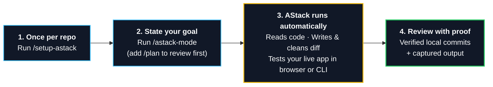

# AStack: Make AI agents prove their work on your running app

> **Don't trust the agent. Trust the evidence.**

<p align="center">
  
</p>

<p align="center">
  <a href="https://github.com/jmxt3/astack/actions/workflows/ci.yml"></a>
  <a href="./plugin.json"></a>
  <a href="https://antigravity.google"></a>
  <a href="https://nodejs.org">= 22.6"></a>
  <a href="https://www.typescriptlang.org"></a>
  <a href="./LICENSE"></a>
</p>

AStack is a Google Antigravity plugin that makes AI agents verify their work on your running app before reporting done. Give [`/astack-mode`](./skills/astack-mode/SKILL.md) a goal, and it selects the right playbook, cleans the diff, and checks behavior in your live browser or terminal. It runs locally with zero external npm dependencies, sends no telemetry, and works with whatever model you pick in Antigravity.

fork it. improve it. make it yours. PRs are welcome!

<p align="center">
  <a href="#why-astack">Why AStack</a> ·
  <a href="#install">Install</a> ·
  <a href="#quick-start">Quick start</a> ·
  <a href="#documentation">Documentation</a> ·
  <a href="#security-and-privacy">Security and privacy</a> ·
  <a href="./CREDITS.md">Credits</a> ·
  <a href="./CONTRIBUTING.md">Contributing</a> ·
  <a href="./SECURITY.md">Security</a>
</p>

## Why AStack

Agents write code fast, and reviewing code nobody ran is slow. With AStack, two commands put live testing on the agent so you review captured evidence instead of guesses.



Use AStack for nontrivial features, root-cause bug fixes, refactors, and PR reviews. For a one-line edit, ask the agent directly.

## Install

Requires **Google Antigravity** and **Node.js `>= 22.6`** (`22.18+` or `23.6+` for unflagged TypeScript type stripping). Install **Java** only if you run live TLA+ model checking via `/statechart`.

```bash
agy plugin install https://github.com/jmxt3/astack
agy plugin list --json
```

To install from a local clone instead, run `agy plugin install .` inside the repository. On Windows, if updating while Antigravity is running fails with `Access is denied`, run `agy plugin uninstall astack` first and reinstall.

## Quick start

1. **Initialize verification once per repo.** Run [`/setup-astack`](./skills/setup-astack/SKILL.md) inside Antigravity and pick the recommended option. It scaffolds `.agents/skills/verify-<app>/` so future runs know how to boot and verify your app.
2. **Run a task with `/astack-mode`.** Describe what you want and how to verify it. Put `/plan` in front whenever you want to approve `implementation_plan.md` before any files change, or `/plan /grill-me` when requirements are still rough.

   ```text
   /astack-mode clicking Save twice on the profile form creates duplicate records. reproduce it in the browser first, fix the root cause, and prove double-clicking saves only once.
   ```

   ```text
   /plan /astack-mode add rate limiting to the login endpoint
   ```

3. **Ask `/astack-help` when unsure.** It recommends the right skill and returns a copy-ready prompt without editing files.

   ```text
   /astack-help which skill should I use to review this branch before opening a PR?
   ```

Enable the optional [`AStack`](./sidecars/astack_timeline/sidecar.json) Timeline sidecar under **Extensions** in Google Antigravity for visual stage tracking and click-to-copy commands.

## Documentation

| Document | Covers |
|---|---|
| [AStack User Guide](./docs/user-guide.md) | Quickstart, plan-first approval workflow, and daily habits |
| [Agent Command Timeline](./docs/agent-timeline.md) | Complete chronological catalog of all skills, playbooks, hooks, and native commands |
| [Hands-On Daily Tutorials](./docs/tutorials/README.md) | End-to-end walkthroughs from tickets and setup to audits and PR reviews |
| [The AStack Guide](./docs/guide/README.md) | 10-chapter course including the [24 engineering principles](./docs/guide/08-principles.md) |
| [Architecture and Swarm](./docs/architecture-and-swarm.md) | Enforcement layers, Orchestrator routing, `astack_trust` MCP server, hooks, and Swarm |
| [Automation Templates](./docs/automations/beacon/README.md) | Opt-in outer-loop templates for `beacon`, [PR triage](./docs/automations/pr-triage/README.md), and [weekly `/correct`](./docs/automations/weekly-correct/README.md) |

## Security and privacy

AStack runs locally with zero external npm dependencies, no hosted servers, no telemetry, and no stored credentials. [`hooks.json`](./hooks.json) enables `3` passive observe-only hooks by default and keeps all `7` blocking safety gates disabled until you opt in. To report a vulnerability, follow [SECURITY.md](./SECURITY.md).

## Credits and license

AStack adapts ideas from Lauren Tan's [`pstack`](https://github.com/cursor/plugins/tree/main/pstack), Garry Tan's [`gstack`](https://github.com/garrytan/gstack), and Cloudflare's [`security-audit-skill`](https://github.com/cloudflare/security-audit-skill). Read [CREDITS.md](./CREDITS.md) for full attribution.

To contribute, read [CONTRIBUTING.md](./CONTRIBUTING.md) and the [Code of Conduct](./CODE_OF_CONDUCT.md), or [open an issue](https://github.com/jmxt3/astack/issues/new/choose).

[João Machete](https://github.com/jmxt3) maintains AStack under the [MIT License](./LICENSE).
