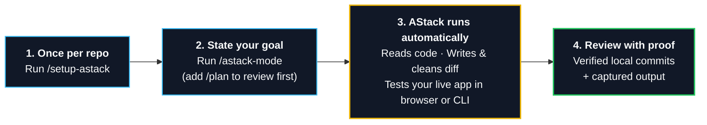
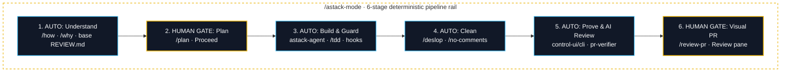

# AStack: Make AI agents prove their work on your running app

> **Don't trust the agent. Trust the evidence.**

<p align="center">
  
</p>

<p align="center">
  <a href="https://github.com/jmxt3/astack/actions/workflows/ci.yml"></a>
  <a href="./plugin.json"></a>
  <a href="https://antigravity.google"></a>
  <a href="https://nodejs.org">= 22.6"></a>
  <a href="https://www.typescriptlang.org"></a>
  <a href="./LICENSE"></a>
</p>

AStack is a Google Antigravity plugin that makes the agent prove its work. You give [`/astack-mode`](./skills/astack-mode/SKILL.md) a goal. It picks a playbook, runs the skills that playbook needs, cleans the diff, and checks the result on your running app before it reports done.

AStack takes inspiration from Lauren Tan's [`pstack`](https://github.com/cursor/plugins/tree/main/pstack) for empirical verification playbooks and Garry Tan's [`gstack`](https://github.com/garrytan/gstack) for structured review gates, and builds those ideas natively for Google Antigravity.

AStack has 66 skills, 26 playbooks, 24 engineering principles, 4 custom agents, 1 routing rule, 10 lifecycle hooks (3 passive observe-only enabled by default plus 7 opt-in blocking gates), 1 local MCP server (`trust`), and 1 optional read-only timeline sidecar UI ([`sidecars/astack_timeline/`](./sidecars/astack_timeline/sidecar.json)), plus opt-in scheduled automation templates under [`docs/automations/`](./docs/automations/beacon/README.md). It runs locally as markdown skills and zero-dependency Node.js scripts. It has no hosted backend, sends no telemetry, and pins no model, so it uses whatever model you pick in Antigravity.

fork it. improve it. make it yours. PRs are welcome!

<p align="center">
  <a href="#why-trust-is-the-limiting-step-loops-you-can-trust">Earned trust</a> ·
  <a href="#install">Install</a> ·
  <a href="#quick-start">Quick start</a> ·
  <a href="#interactive-plan-review--execute-workflow">Plan &amp; review</a> ·
  <a href="#how-it-fits-together">How it fits</a> ·
  <a href="#skill-catalog">66 skills</a> ·
  <a href="./docs/user-guide.md">User guide</a> ·
  <a href="./docs/tutorials/README.md">Tutorials</a> ·
  <a href="./CREDITS.md">Credits</a> ·
  <a href="./CONTRIBUTING.md">Contributing</a> ·
  <a href="./SECURITY.md">Security</a>
</p>

## Why trust is the limiting step (Loops You Can Trust)

An agent writes code fast. Reviewing code that nobody ran is slow. If the agent says "all tests pass" without running your app, the checking still falls on you.

With AStack, you only need two commands, and [`/astack-mode`](./skills/astack-mode/SKILL.md) handles the live testing behind the scenes:



1. **Set up once ([`/setup-astack`](./skills/setup-astack/SKILL.md)).** Teaches AStack how to start and check your project.
2. **Give a goal ([`/astack-mode`](./skills/astack-mode/SKILL.md)).** Add `/plan` in front whenever you want to approve the plan before any files change.
3. **Review the proof, not guesses.** `/astack-mode` automatically reads your codebase, writes and cleans the diff, runs your real app in the browser or terminal, and hands back captured output.

AStack fits nontrivial features, root-cause bug fixes, refactors, and PR reviews. For a one-line typo fix, ask the agent directly.

## Install

Requires **Google Antigravity** and **Node.js `>= 22.6`** (`22.18+` or `23.6+` for unflagged TypeScript type stripping). Install **Java** only if you run live TLC model checking through `/statechart`.

Install directly from GitHub and verify plugin registration:

```bash
agy plugin install https://github.com/jmxt3/astack
agy plugin list --json
```

To install from a local clone instead, run `agy plugin install ./astack` (or `agy plugin install .` inside the repository). On Windows, if updating while Antigravity is running fails with `Access is denied`, run `agy plugin uninstall astack` first and reinstall.

## Quick start

1. **Initialize verification in your repository once** by running `/setup-astack` inside Antigravity and picking the recommended option. It inspects your project and scaffolds `.agents/skills/verify-<app>/` so future runs know how to start and verify your app.
2. **Run a task with `/astack-mode`** by stating what you want and how to check it works:

   ```text
   /astack-mode clicking Save twice on the profile form creates duplicate records. reproduce it in the browser first, fix the root cause, and prove double-clicking saves only once.
   ```

3. **Ask `/astack-help` when unsure** to get a recommended skill, reasoning, and copy-ready prompt without spending execution turns:

   ```text
   /astack-help which skill should I use to review this branch before opening a PR?
   ```

## Interactive plan, review & execute workflow

To approve the plan before any file changes, put `/plan` in front of `/astack-mode`:

```text
/plan /astack-mode add rate limiting to the login endpoint
```

1. The agent reads the code and writes `implementation_plan.md`. It edits no files.
2. You comment on the plan in Antigravity and click **Proceed** when it is right.
3. The agent carries out the plan and proves the result.

If your idea is still rough, start with `/plan /grill-me <idea>`. The agent asks you one question at a time and then writes the plan. [Part 2 of the User Guide](./docs/user-guide.md#part-2-plan-first-workflow-write-a-plan-approve-then-execute) has more examples.

## How it fits together

Most work flows through a deterministic 6-stage pipeline when you invoke [`/astack-mode`](./skills/astack-mode/SKILL.md). Stages 1, 3, 4, and 5 advance automatically (`[AUTO]`), while Stage 2 (Implementation Plan) and Stage 6 (Visual PR Review) enforce human gates (`[HUMAN GATE]`) unless a repo explicitly opts Tier 0 into auto-merge:



To follow that path visually inside Google Antigravity, enable the optional [`AStack Timeline`](./sidecars/astack_timeline/sidecar.json) sidecar panel under **Extensions**. It shows the 4 per-conversation stages (`/plan` with `/grill-me`, `/astack-mode` with `/interrogate`, `/review-pr`, and `open the pr`), surfaces one-time `/setup-astack` readiness conditionally per repo (a first-time onboarding card when unconfigured, or a compact `Setup ready` header toggle once configured), supports click-to-copy command chips ready to paste in chat, and exposes a once-per-session `[AStack Timeline](sidecar://astack/astack_timeline/)` chat pill when enabled.

## Skill catalog

AStack ships **66 skills** (`skills/`), **4 agents** (`agents/`), **1 routing rule** (`rules/`), and **10 lifecycle hooks** (`hooks.json`):

### Orchestration & setup (3)

| Skill | Purpose |
|---|---|
| [`/astack-mode`](./skills/astack-mode/SKILL.md) | Main entry point routing tasks across 26 playbooks, 24 principles, subagents, and Antigravity multi-agent modes |
| [`/astack-help`](./skills/astack-help/SKILL.md) | Recommends the right skill and gives a copy-paste prompt without spending execution turns |
| [`/setup-astack`](./skills/setup-astack/SKILL.md) | Scaffolds repo-local `verify-<app>` verification skills, optional formal verification, and workspace `--doctor` checks |

<details>
<summary>26 playbooks inside /astack-mode (skills/astack-mode/playbooks/)</summary>

| Playbook | When `/astack-mode` uses it |
|---|---|
| [`authoring-a-skill.md`](./skills/astack-mode/playbooks/authoring-a-skill.md) | Creating or editing an Antigravity `SKILL.md` under 24,000 bytes |
| [`autonomous-run.md`](./skills/astack-mode/playbooks/autonomous-run.md) | Driving unattended `/goal` tasks toward a checkable finish predicate |
| [`autopilot-full.md`](./skills/astack-mode/playbooks/autopilot-full.md) | Swarm-verified multi-PR execution with independent verification before merge |
| [`autopilot-stack.md`](./skills/astack-mode/playbooks/autopilot-stack.md) | Building and verifying a stacked PR sequence without merging |
| [`babysit.md`](./skills/astack-mode/playbooks/babysit.md) | Driving open PRs to green checks and resolving review threads |
| [`bug-fix.md`](./skills/astack-mode/playbooks/bug-fix.md) | Reproducing a bug live first, tracing root cause, and verifying the fix |
| [`eval.md`](./skills/astack-mode/playbooks/eval.md) | Designing, blinding, running, and synthesizing controlled experiments |
| [`feature.md`](./skills/astack-mode/playbooks/feature.md) | Domain-first feature implementation with boundary checks and verification |
| [`hillclimb.md`](./skills/astack-mode/playbooks/hillclimb.md) | Iterating repeatedly on one measurable metric against a target |
| [`investigation.md`](./skills/astack-mode/playbooks/investigation.md) | Read-only evidence gathering and cited diagnosis without editing code |
| [`multi-phase-plan.md`](./skills/astack-mode/playbooks/multi-phase-plan.md) | Writing a verifiable multi-phase or multi-PR execution checklist |
| [`opening-a-pr.md`](./skills/astack-mode/playbooks/opening-a-pr.md) | Packaging a clean, verified diff and concise PR summary |
| [`orchestrate.md`](./skills/astack-mode/playbooks/orchestrate.md) | Multi-day coordinator loop across Swarm workers and milestone gates |
| [`pause-safely.md`](./skills/astack-mode/playbooks/pause-safely.md) | Leaving an explicit checkpoint for cold-start resumption on interruption |
| [`perf-issue.md`](./skills/astack-mode/playbooks/perf-issue.md) | Profiling bottlenecks and vetting before/after latency or throughput claims |
| [`prototype.md`](./skills/astack-mode/playbooks/prototype.md) | Running throwaway empirical prototypes to settle design or UI questions |
| [`refactoring.md`](./skills/astack-mode/playbooks/refactoring.md) | Changing internal structure while proving identical observable behavior |
| [`release-and-postmortem.md`](./skills/astack-mode/playbooks/release-and-postmortem.md) | Evidence-backed release notes, read-only deploy smoke checks, and permanent postmortem fixes |
| [`runtime-forensics.md`](./skills/astack-mode/playbooks/runtime-forensics.md) | Instrumenting live processes for runtime diagnosis instead of guessing |
| [`safe-migration.md`](./skills/astack-mode/playbooks/safe-migration.md) | Zero-downtime expand/backfill/switch/contract schema migrations with local rollback proof |
| [`security-audit.md`](./skills/astack-mode/playbooks/security-audit.md) | Coverage-led vulnerability audit, PR-diff boundary checks, and sandboxed PoC handoff |
| [`session-pickup.md`](./skills/astack-mode/playbooks/session-pickup.md) | Resuming interrupted work from decision trails and repository state |
| [`shipping.md`](./skills/astack-mode/playbooks/shipping.md) | Landing a verified PR stack sequentially after independent verification |
| [`trace-forensics.md`](./skills/astack-mode/playbooks/trace-forensics.md) | Diagnosing failures directly from captured trace artifacts and logs |
| [`visual-parity.md`](./skills/astack-mode/playbooks/visual-parity.md) | Pixel-exact UI comparison verified via automated image diffs |
| [`worktree-cleanup.md`](./skills/astack-mode/playbooks/worktree-cleanup.md) | Auditing and cleaning merged or stale git worktrees with `worktree-audit.mjs` |

</details>

### Understanding & recall (5)

| Skill | Purpose |
|---|---|
| [`/how`](./skills/how/SKILL.md) | Explains subsystem architecture, runtime flow, ownership, and layering before edits |
| [`/why`](./skills/why/SKILL.md) | Investigates why code or rules exist using git history, PRs, and connected MCP sources |
| [`/teach`](./skills/teach/SKILL.md) | Combines `/how` and `/why` into a plain-language explanation of a subsystem or PR |
| [`/recall`](./skills/recall/SKILL.md) | Mines recent Antigravity transcripts and live repo or PR state across sessions |
| [`/in-your-own-words`](./skills/in-your-own-words/SKILL.md) | Restates the user's goal and underlying problem before starting work |

### Design & parallel exploration (7)

| Skill | Purpose |
|---|---|
| [`/architect`](./skills/architect/SKILL.md) | Explores competing architectures in parallel, checks design red flags, and writes a type sketch |
| [`/audit-architecture`](./skills/audit-architecture/SKILL.md) | Audits `.agents/boundaries.json`, Ousterhout shallow modules, and stale workaround examples |
| [`/arena`](./skills/arena/SKILL.md) | Runs 2 to 3 isolated candidate implementations against the same check and grafts winning pieces |
| [`/fanout`](./skills/fanout/SKILL.md) | Fans out independent read-only sweeps, test matrices, or file-disjoint tasks to subagents |
| [`/interrogate`](./skills/interrogate/SKILL.md) | Stress-tests built prototypes, contested designs, and branch diffs with adversarial runs |
| [`/sharpen`](./skills/sharpen/SKILL.md) | Refines a task to be deeper rather than broader and rewrites the prompt |
| [`/figure-it-out`](./skills/figure-it-out/SKILL.md) | Designs an auditable hypothesis loop for open-ended migrations and multi-part changes |

### Verification & formal checks (14)

| Skill | Purpose |
|---|---|
| [`/control-ui`](./skills/control-ui/SKILL.md) | Verifies live web and Electron UIs via `browser` subagent and Chrome DevTools MCP |
| [`/design-audit`](./skills/design-audit/SKILL.md) | Empirical UX, accessibility, responsive layout, and UI state audit when no pixel baseline exists yet |
| [`/control-cli`](./skills/control-cli/SKILL.md) | Verifies CLIs, daemons, and HTTP or RPC services against temp workspaces, exit codes, and cleanup |
| [`/review-pr`](./skills/review-pr/SKILL.md) | Compiles visual Markdown, Mermaid, and carousel PR dossiers with Risk Tiers (0–3) and isolated `pr-verifier` checks |
| [`/security-audit`](./skills/security-audit/SKILL.md) | Coverage-led vulnerability audit (`Guidance` and 6-phase `Full Audit`), JSON schema validators, and remediation handoff |
| [`/create-verification-skill`](./skills/create-verification-skill/SKILL.md) | Generates a repo-local `verify-<app>` skill and `features/` sitemap |
| [`/maintain-verification-skill`](./skills/maintain-verification-skill/SKILL.md) | Audits and updates a project's `verify-<app>` skill against current code and live UI or CLI flows |
| [`/create-formal-verification-skill`](./skills/create-formal-verification-skill/SKILL.md) | Scaffolds TLA+ formal specification checks for stateful protocols and concurrency invariants |
| [`/maintain-formal-verification-skill`](./skills/maintain-formal-verification-skill/SKILL.md) | Audits existing TLA+ models and specs against code changes |
| [`/statechart`](./skills/statechart/SKILL.md) | Runs TLA+ / TLC checks (`statechart.mjs`) and outputs Mermaid statecharts plus shortest failing paths |
| [`/benchmark-checklist`](./skills/benchmark-checklist/SKILL.md) | Vets measured latency, throughput, and speedup numbers before reporting results |
| [`/blast-radius`](./skills/blast-radius/SKILL.md) | Finds non-local callers or invariants a small diff could break and proves safety with real execution |
| [`/tdd`](./skills/tdd/SKILL.md) | Drives cheap local failing-test-first loops when explicitly requested or clearly bounded |
| [`/show-me-your-work`](./skills/show-me-your-work/SKILL.md) | Records structured decision logs (`decisions.tsv`) and receipts for long autonomous runs |

### Code, prose & workflow hygiene (6)

| Skill | Purpose |
|---|---|
| [`/deslop`](./skills/deslop/SKILL.md) | Pre-commit cleanup stripping single-caller helpers, dead compatibility shims, and unrelated edits |
| [`/no-comments`](./skills/no-comments/SKILL.md) | Spawns `comment-sicko` to delete narrating comments and encode real constraints in types or lints |
| [`/unslop`](./skills/unslop/SKILL.md) | Removes AI phrasing tells, filler words, and mannered prose from docs and replies |
| [`/technical-writing`](./skills/technical-writing/SKILL.md) | Layered writing standard (Diátaxis, Google developer style, STE rules, Global English) |
| [`/typescript-best-practices`](./skills/typescript-best-practices/SKILL.md) | TypeScript patterns for discriminated unions, boundary parsing, and exhaustive matching |
| [`/correct`](./skills/correct/SKILL.md) | Pushes recurring mistakes up the stack into architecture, types, lints, or tests |

### Session catch-up, reflection & automation (7)

| Skill | Purpose |
|---|---|
| [`/ketchup`](./skills/ketchup/SKILL.md) | Plain-language summary of what changed since your last message plus decisions waiting on you |
| [`/ketchup-video`](./skills/ketchup-video/SKILL.md) | Renders a short subtitled slide video catch-up with pending decisions underneath |
| [`/reflect`](./skills/reflect/SKILL.md) | Reviews the active transcript with three parallel reviewers and turns lessons into skill edits |
| [`/automate-me`](./skills/automate-me/SKILL.md) | Turns your recurring working conventions into a personal `-mode` skill |
| [`/make-bot-ui`](./skills/make-bot-ui/SKILL.md) | Builds safe webhook-backed UI triggers and Tailscale setups for Antigravity automations |
| [`/beast-mode`](./skills/beast-mode/SKILL.md) | Configures earned autonomy (`Auto` or `Manual` promotion) inside human-set policy Ceilings |
| [`/bro`](./skills/bro/SKILL.md) | Restates the last agent response in plain human language with no jargon |

<details>
<summary>24 engineering principles (surfaced and cited automatically by /astack-mode)</summary>

| Principle | Group | Decision rule |
|---|---|---|
| [`principle-laziness-protocol`](./skills/principle-laziness-protocol/SKILL.md) | Core | Bias toward deletion and the smallest sound change |
| [`principle-foundational-thinking`](./skills/principle-foundational-thinking/SKILL.md) | Core | Get core types and data structures right before writing logic |
| [`principle-redesign-from-first-principles`](./skills/principle-redesign-from-first-principles/SKILL.md) | Core | Redesign structure cleanly instead of bolting patches onto old assumptions |
| [`principle-attack-the-premise`](./skills/principle-attack-the-premise/SKILL.md) | Core | Test the shared premise directly after two failed fixes hit the same gate |
| [`principle-subtract-before-you-add`](./skills/principle-subtract-before-you-add/SKILL.md) | Core | Remove dead code and redundant checks before building new behavior |
| [`principle-minimize-reader-load`](./skills/principle-minimize-reader-load/SKILL.md) | Core | Collapse one-caller wrappers and shrink mutable scope |
| [`principle-outcome-oriented-execution`](./skills/principle-outcome-oriented-execution/SKILL.md) | Core | Converge to the target design during migrations instead of keeping shims |
| [`principle-experience-first`](./skills/principle-experience-first/SKILL.md) | Core | Choose user experience over implementation convenience |
| [`principle-exhaust-the-design-space`](./skills/principle-exhaust-the-design-space/SKILL.md) | Core | Compare 2 to 3 prototypes side by side for novel interactions or designs |
| [`principle-build-the-lever`](./skills/principle-build-the-lever/SKILL.md) | Core | Build repeatable verification or migration scripts instead of editing by hand |
| [`principle-model-the-domain`](./skills/principle-model-the-domain/SKILL.md) | Architecture | Replace scattered conditionals with explicit tables or state machines |
| [`principle-boundary-discipline`](./skills/principle-boundary-discipline/SKILL.md) | Architecture | Validate untrusted inputs at boundaries and keep core functions pure |
| [`principle-type-system-discipline`](./skills/principle-type-system-discipline/SKILL.md) | Architecture | Make illegal states unrepresentable and parse external payloads once |
| [`principle-make-operations-idempotent`](./skills/principle-make-operations-idempotent/SKILL.md) | Architecture | Ensure commands and loops converge to the same state across retries |
| [`principle-migrate-callers-then-delete-legacy-apis`](./skills/principle-migrate-callers-then-delete-legacy-apis/SKILL.md) | Architecture | Migrate all callers and remove old internal APIs in one wave |
| [`principle-separate-before-serializing-shared-state`](./skills/principle-separate-before-serializing-shared-state/SKILL.md) | Architecture | Isolate concurrent writers in separate workspaces before locking shared state |
| [`principle-prove-it-works`](./skills/principle-prove-it-works/SKILL.md) | Verification | Prove behavior on the running surface rather than relying on mocks or builds |
| [`principle-fix-root-causes`](./skills/principle-fix-root-causes/SKILL.md) | Verification | Fix the earliest broken invariant instead of masking invalid state |
| [`principle-sequence-verifiable-units`](./skills/principle-sequence-verifiable-units/SKILL.md) | Verification | Break large changes into units that each end in an empirical check |
| [`principle-test-behavior-not-implementation`](./skills/principle-test-behavior-not-implementation/SKILL.md) | Verification | Assert observable caller contracts rather than private internals |
| [`principle-explain-the-number`](./skills/principle-explain-the-number/SKILL.md) | Verification | Identify what limits any benchmark or metric before reporting it |
| [`principle-guard-the-context-window`](./skills/principle-guard-the-context-window/SKILL.md) | Delegation | Offload noisy sweeps to subagents and keep crisp summaries in the main thread |
| [`principle-never-block-on-the-human`](./skills/principle-never-block-on-the-human/SKILL.md) | Delegation | Execute, verify, and report reversible local work without waiting |
| [`principle-encode-lessons-in-structure`](./skills/principle-encode-lessons-in-structure/SKILL.md) | Meta | Encode repeated corrections in types, lints, hooks, or tests instead of prose |

</details>

- **Custom agents (`agents/`)**: [`astack-engineer`](./agents/astack-engineer.md) (primary `agy --agent astack-engineer` entry booting straight into AStack rigor), [`astack-agent`](./agents/astack-agent.md) (verification-first builder delegate with anti-rationalization discipline), [`pr-verifier`](./agents/pr-verifier.md) (isolated `inheritCustomizations: false` read-only PR verifier), and [`comment-sicko`](./agents/comment-sicko.md) (isolated `inheritCustomizations: false` adversarial comment and suppression auditor).
- **Routing rule (`rules/`)**: [`astack-orchestration.md`](./rules/astack-orchestration.md).
- **Local MCP server & MCP Apps ([`mcp_config.json`](./mcp_config.json))**: zero-dependency local `stdio` server (`astack_trust`) exposing `compile_pr_dossier`, `audit_architecture`, `doctor_workspace`, `get_trust_status`, `record_proof_manifest`, inline chat cards, and a `.tla` formal spec viewer (`ui://astack/tla-viewer.html`).
- **Dynamic Workflows & CLI helpers**: reusable `/run-workflow` Python scripts under `skills/{review-pr,fanout,reflect}/scripts/workflows/` plus zero-spawn CLI `statusLine` and `title` scripts under `scripts/cli/`.
- **Lifecycle hooks (`hooks.json`)**: 3 passive observe-only hooks enabled by default (`astack-receipt-ledger` on `PostToolUse`, `astack-session-context` on `SessionStart`, and `astack-pr-intent` on `PreInvocation`) plus 7 opt-in blocking gates (`astack-irreversible-guard`, `astack-secret-guard`, `astack-verify-reminder`, `astack-evidence-gate`, `astack-boundary-guard`, `astack-round-limiter`, `astack-trust-gate`).

## Documentation

### Core guides & references

| Goal | Documents |
|---|---|
| Single-page quickstart, plan-approve-execute workflow, 5-stage guide, and power moves | [AStack User Guide](./docs/user-guide.md) · [Plan-First Workflow](./docs/user-guide.md#part-2-plan-first-workflow-write-a-plan-approve-then-execute) |
| Chronological agent reference covering all main commands, practical examples, and tutorial links | [Agent Command Timeline](./docs/agent-timeline.md) |
| Hands-on daily walkthroughs along the full delivery timeline (tickets, setup, feature gates, pre-PR UI/migration/security audits, PR babysit & release, batch reviews) | [Hands-On Daily Tutorials](./docs/tutorials/README.md) |
| Step-by-step 10-chapter onboarding course | [The AStack Guide](./docs/guide/README.md) |
| 5-layer enforcement model, dynamic bidirectional model routing, Control Glass, and Antigravity mode matrix | [Architecture & Swarm](./docs/architecture-and-swarm.md) · [Swarm Coordination Reference](./skills/astack-mode/references/swarm-coordination.md) |
| Prompting patterns, copy-paste recipes, and review checklists | [Prompting Guide](./skills/astack-help/references/prompting.md) · [Prompt Recipes](./skills/astack-help/references/recipes.md) · [Bugbot & Review Triage](./skills/astack-mode/references/bugbot-triage.md) · [DevTools Evidence Checklist](./skills/control-ui/references/devtools-evidence-checklist.md) · [Design Red Flags](./skills/architect/references/design-red-flags.md) · [TypeScript Patterns](./skills/typescript-best-practices/references/patterns.md) |
| Outer-loop Slack issue triage and reproduction automation | [Beacon Automation Overview](./docs/automations/beacon/README.md) · [Beacon Agent Setup Runbook](./docs/automations/beacon/FOR_AGENTS.md) |
| Verify AStack's own CLIs, hooks, command surfaces, and read-only watch tooling | [Verify AStack (`verify-astack`)](./.agents/skills/verify-astack/SKILL.md) · [Verification Feature Map](./.agents/skills/verify-astack/features/README.md) · [Sync AStack Surfaces](./.agents/skills/sync-astack-surfaces/SKILL.md) · [Upstream Watch Feature](./.agents/skills/verify-astack/features/upstream-watch.md) |
| Lineage, open-source credits, community standards, security policy, and license | [Credits & Lineage](./CREDITS.md) · [Contributing Guide](./CONTRIBUTING.md) · [Code of Conduct](./CODE_OF_CONDUCT.md) · [Security Policy](./SECURITY.md) · [MIT License](./LICENSE) |

### 10-chapter tutorial (`docs/guide/`)

1. [Set up AStack](./docs/guide/01-setup.md): install the plugin, use any model on your plan, and scaffold verification.
2. [Route work through `/astack-mode`](./docs/guide/02-astack-mode.md): give a goal, gate execution behind plan approval, and let `/astack-mode` pick the playbook.
3. [Understand the code](./docs/guide/03-understand.md): read-only investigation with `/how`, `/why`, `/teach`, and `/recall`.
4. [Design the change](./docs/guide/04-design.md): `/architect` checkpoints, `/arena`, `/fanout`, `/interrogate`, prototypes, and approved multi-PR plans.
5. [Build and clean the change](./docs/guide/05-build-and-clean.md): build playbooks, `/tdd`, `/deslop`, `/unslop`, and `/no-comments`.
6. [Verify and ship](./docs/guide/06-verify-and-ship.md): Control Glass verification, formal TLA+ checks, `/benchmark-checklist`, and PR shipping.
7. [Run work while you sleep](./docs/guide/07-overnight.md): `/goal` contracts, `decisions.tsv` audit logs, `/schedule`, `/automation`, Remote Agents, and Remote Control.
8. [Steer with principle names](./docs/guide/08-principles.md): redirect agents mid-task using the 24 named principles.
9. [Make it yours](./docs/guide/09-make-it-yours.md): personal `-mode` skills, `/correct`, and testing skill edits.
10. [Recipes and pitfalls](./docs/guide/10-recipes-and-pitfalls.md): ready-to-copy prompts and common anti-patterns.

## Security & lifecycle hooks

AStack runs locally with zero external npm dependencies. It starts no hosted servers, sends no telemetry, and stores no credentials. When you enable the optional [`AStack Timeline`](./sidecars/astack_timeline/sidecar.json) sidecar in Antigravity, Antigravity launches one read-only localhost HTTP panel bound to `127.0.0.1` that inspects local transcripts, workspace readiness, and `astack-trust` receipts without mutating files or sending agent messages. [`hooks.json`](./hooks.json) enables three passive observe-only hooks (`astack-receipt-ledger`, `astack-session-context`, and `astack-pr-intent`) by default while keeping all six blocking gates (`astack-irreversible-guard`, `astack-verify-reminder`, `astack-secret-guard`, `astack-evidence-gate`, `astack-boundary-guard`, and `astack-round-limiter`) disabled until opted in. Dormant scheduled automation templates live under [`docs/automations/`](./docs/automations/beacon/README.md) ([PR triage](./docs/automations/pr-triage/README.md), [weekly `/correct`](./docs/automations/weekly-correct/README.md)).

To report a vulnerability, follow [SECURITY.md](./SECURITY.md).

## Credits & license

AStack adapts foundations from Lauren Tan's [`pstack`](https://github.com/cursor/plugins/tree/main/pstack), Garry Tan's [`gstack`](https://github.com/garrytan/gstack), and Cloudflare's [`security-audit-skill`](https://github.com/cloudflare/security-audit-skill). Read [CREDITS.md](./CREDITS.md) for full attribution.

To contribute, read [CONTRIBUTING.md](./CONTRIBUTING.md) and the [Code of Conduct](./CODE_OF_CONDUCT.md), or [open an issue](https://github.com/jmxt3/astack/issues/new/choose).

[João Machete](https://github.com/jmxt3) maintains AStack under the [MIT License](./LICENSE).
