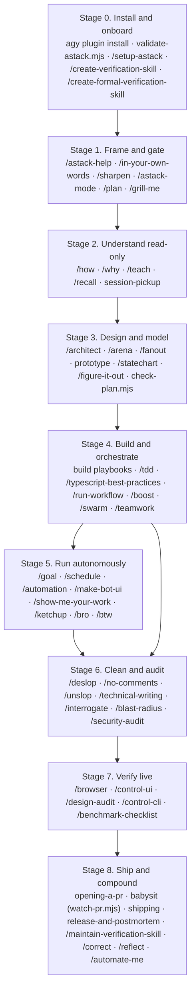

# AStack agent command timeline

This guide shows an AI agent how to operate **AStack** (`astack`, sometimes called Aistack) from repository setup through shipping and self-improvement. Commands appear in the exact chronological order an engineering task follows. Every stage names what each command does, when to trigger it, which workspace isolation or gate applies, and which worked tutorials demonstrate it.

## How AStack works for an AI agent

AStack is a local Google Antigravity plugin (`plugin.json` v0.2.0) backed by markdown skills, playbooks, custom agents, and Node 22+ scripts. It ships `63` skills (`29` auto-invocable workflow skills, `24` `principle-*` skills, and `10` manual-only explicit entrypoints listed in [`scripts/catalog.json`](../scripts/catalog.json)), `26` playbooks under `skills/astack-mode/playbooks/`, `2` custom agents ([`astack-agent`](../agents/astack-agent.md) and [`comment-sicko`](../agents/comment-sicko.md)), `1` conditional rule ([`rules/astack-orchestration.md`](../rules/astack-orchestration.md)), `3` opt-in lifecycle hooks ([`hooks.json`](../hooks.json)), and `11` bundled CLI scripts.

Follow five core rules on every run:

1. **Let `/astack-mode` route the workflow.** Give `/astack-mode` a concrete goal and a pass-or-fail done check instead of chaining skill names manually.
2. **Prove behavior on the running surface.** Never treat passing compilation, lint, or mocked unit tests as proof (`principle-prove-it-works`). Exercise the live UI, CLI, API, or repo verification skill and capture observed output.
3. **Preserve model inheritance.** Leave `Model` unset (`inherit`) on `invoke_subagent` and `swarm{action: "add"}` so workers follow the active Antigravity UI selector and **Orchestrator** dynamic bidirectional routing (**Carbon** on Google AI Ultra or **Argon** on Pro and Ultra paired with **Gemini 4 Hydrogen**). Use evergreen `flash` only for high-volume `research` or `browser` sweeps, and discover live models via `swarm{action: "models", all: true}` only for cross-family bakeoffs or independent `@verifier` checks.
4. **Never shadow Antigravity's 16 native slash commands.** Engage `/plan`, `/grill-me`, `/learn`, `/swarm`, `/run-workflow`, `/schedule`, `/browser`, `/automation`, `/plugin`, `/agy-customizations`, `/generative_ui`, `/antigravity-guide`, `/goal`, `/boost`, `/teamwork`, and `/btw` through their documented modes in [`native-commands.md`](../skills/astack-mode/references/native-commands.md).
5. **Isolate parallel writers and pause before external mutations.** Use `Workspace: "share"` or `"branch"` whenever concurrent workers write code, and stop at verified local commits before `git push` or `gh pr create` unless the user requested push, PR creation, `autopilot-*`, or `shipping`.



## Master command timeline

Scan this chronological table to see every main AStack command, native Antigravity integration, and bundled CLI in execution order.

| Order | Stage | Command or Invocation | Primary Function | Section |
|---|---|---|---|---|
| 1 | Stage 0 | `agy plugin install` and `agy plugin list --json` | Install AStack globally and verify plugin registration | [Stage 0](#stage-0-install-inspect-and-onboard-once-per-repository) |
| 2 | Stage 0 | `node scripts/validate-astack.mjs` and `node --run test` | Validate manifest, frontmatter, links, leaks, and plugin suites | [Validate AStack](#node-scriptsvalidate-astackmjs-and-node---run-test) |
| 3 | Stage 0 | `/setup-astack` and `setup-banner.mjs --doctor` | Inspect repo health and launch onboarding selectors | [Setup AStack](#setup-astack-and-setup-bannermjs) |
| 4 | Stage 0 | `/create-verification-skill` | Generate `.agents/skills/verify-<app>/` and `features/` map | [Create verification skill](#create-verification-skill) |
| 5 | Stage 0 | `/create-formal-verification-skill` | Scaffold TLA+ or TypeScript formal invariant checks | [Create formal verification skill](#create-formal-verification-skill) |
| 6 | Stage 0 | `hooks.json` and `rules/astack-orchestration.md` | Enable opt-in safety guards and always-on routing rules | [Opt-in hooks](#opt-in-lifecycle-hooks-hooksjson-and-always-on-rules) |
| 7 | Stage 1 | `/astack-help` | Recommend a skill and prompt without executing edits | [AStack Help](#astack-help) |
| 8 | Stage 1 | `/in-your-own-words` | Restate the ticket or goal read-only before coding | [In Your Own Words](#in-your-own-words) |
| 9 | Stage 1 | `/sharpen` | Deepen an underspecified prompt without running it | [Sharpen](#sharpen) |
| 10 | Stage 1 | `/astack-mode` and `new task.` | Route goal to a playbook, checklist, and execution tier | [AStack Mode](#astack-mode-and-new-task) |
| 11 | Stage 1 | `/plan` (`plan-contract.md`) | Write `implementation_plan.md` and pause for **Proceed** | [Plan](#plan) |
| 12 | Stage 1 | `/grill-me` | Ask sequential `ask_question` decisions to clarify specs | [Grill Me](#grill-me) |
| 13 | Stage 2 | `/how` | Explain current subsystem runtime flow and ownership | [How](#how) |
| 14 | Stage 2 | `/why` | Trace git history, PRs, and MCPs for design rationale | [Why](#why) |
| 15 | Stage 2 | `/teach` | Combine `/how` and `/why` into diagrammed explanation | [Teach](#teach) |
| 16 | Stage 2 | `/recall` | Reconstruct recent chat transcripts and shared record | [Recall](#recall) |
| 17 | Stage 2 | `/astack-mode take over this branch` (`session-pickup.md`) | Resume an interrupted branch or decision log cleanly | [Session pickup](#session-pickup-session-pickupmd) |
| 18 | Stage 3 | `/architect` | Explore parallel candidate architectures and screen red flags | [Architect](#architect) |
| 19 | Stage 3 | `/arena` | Race isolated candidates, judge cross-family, and graft wins | [Arena](#arena) |
| 20 | Stage 3 | `/fanout` | Run N independent parallel slices or race arms via subagents | [Fanout](#fanout) |
| 21 | Stage 3 | `/astack-mode prototype` (`prototype.md`) | Build throwaway variants in scratch to settle open choices | [Throwaway prototyping](#throwaway-prototyping-prototypemd) |
| 22 | Stage 3 | `/statechart` and `statechart.mjs` | Model-check TLA+ specs and render Mermaid bug paths | [Statechart](#statechart-statechartmjs) |
| 23 | Stage 3 | `/figure-it-out` | Design an auditable hypothesis loop for unmapped work | [Figure It Out](#figure-it-out) |
| 24 | Stage 3 | `multi-phase-plan.md` and `check-plan.mjs` | Build and validate multi-PR execution checklists | [Multi-phase planning](#multi-phase-planning-multi-phase-planmd-and-check-planmjs) |
| 25 | Stage 4 | `/astack-mode` build, forensics, migration, and eval playbooks | Execute `feature`, `bug-fix`, `refactoring`, `perf-issue`, `hillclimb`, forensics, `safe-migration`, `visual-parity`, `authoring-a-skill`, or `eval` | [Build playbooks](#build-playbooks-inside-astack-mode) |
| 26 | Stage 4 | `/tdd` | Write minimal failing test before fixing a cheap local bug | [TDD](#tdd) |
| 27 | Stage 4 | `/typescript-best-practices` | Enforce discriminated unions, `unknown` parsing, and strict TS | [TypeScript best practices](#typescript-best-practices) |
| 28 | Stage 4 | `invoke_subagent`, `/run-workflow`, `/boost`, `/swarm`, `/teamwork` | Scale across focused subagents, Python pipelines, deep debugging, shared Swarm boards, or multi-milestone programs | [Multi-agent orchestration](#multi-agent-orchestration-commands) |
| 29 | Stage 5 | `/goal` (`autonomous-run.md`) | Drive unattended iterations until a pass or fail predicate holds | [Goal](#goal-autonomous-runmd) |
| 30 | Stage 5 | `/schedule` | Set in-session one-shot timers or recurring cron triggers | [Schedule](#schedule) |
| 31 | Stage 5 | `/automation` and `docs/automations/beacon/` | Configure App persistent background triggers (`sidecar.json`) | [Automation](#automation-and-docsautomationsbeacon) |
| 32 | Stage 5 | `/make-bot-ui` | Build a local Tailscale button UI waking automation webhooks | [Make Bot UI](#make-bot-ui) |
| 33 | Stage 5 | `/show-me-your-work` and `log.mjs` | Log append-only TSV decisions and audit against transcripts | [Show Me Your Work](#show-me-your-work-logmjs) |
| 34 | Stage 5 | `/ketchup` and `/ketchup-video` | Summarize changes and open human decisions in plain text or MP4 | [Ketchup and Ketchup Video](#ketchup-and-ketchup-video) |
| 35 | Stage 5 | `/bro`, `/btw`, and `pause-safely.md` | Restate replies plainly, ask side questions, or checkpoint WIP | [Bro, Btw, and Pause safely](#bro-and-btw) |
| 36 | Stage 6 | `/deslop` | Strip single-caller wrappers, dead shims, and bloat, then re-verify | [Deslop](#deslop) |
| 37 | Stage 6 | `/no-comments` (`comment-sicko`) | Delete narrating comments and flag `MUST KILL` workarounds | [No Comments](#no-comments-comment-sicko) |
| 38 | Stage 6 | `/unslop` and `/technical-writing` | Remove AI tells and enforce 4-layer technical writing rules | [Unslop and Technical Writing](#unslop-and-technical-writing) |
| 39 | Stage 6 | `/interrogate` | Run adversarial branch review keeping only live-reproduced bugs | [Interrogate](#interrogate) |
| 40 | Stage 6 | `/blast-radius` | Prove downstream caller, wire, and DB safety with live code | [Blast Radius](#blast-radius) |
| 41 | Stage 6 | `/security-audit` (`security-audit.md`) | Run PR-diff security guidance or 6-phase coverage-led audits | [Security Audit](#security-audit-security-auditmd) |
| 42 | Stage 7 | `/browser` and `/control-ui` | Boot isolated UI servers, drive user flows, and verify state | [Browser and Control UI](#browser-and-control-ui) |
| 43 | Stage 7 | `/design-audit` | Audit desktop and mobile layout, ARIA, focus, and UI states | [Design Audit](#design-audit) |
| 44 | Stage 7 | `/control-cli` | Drive CLIs, TUIs, daemons, and APIs in isolated temp state | [Control CLI](#control-cli) |
| 45 | Stage 7 | `/benchmark-checklist` | Vet performance speedups across 7 empirical questions | [Benchmark Checklist](#benchmark-checklist) |
| 46 | Stage 8 | `/astack-mode open the pr` (`opening-a-pr.md`) | Rebase ordered commits, clean prose, and open ready PRs | [Opening a PR](#astack-mode-open-the-pr-opening-a-prmd) |
| 47 | Stage 8 | `/astack-mode babysit` (`babysit.md` and `watch-pr.mjs`) | Drive open PRs to merge-ready, triage Bugbot, and watch queues | [Babysit PRs](#astack-mode-babysit-babysitmd-and-watch-prmjs) |
| 48 | Stage 8 | `/astack-mode land the stack` (`shipping.md`) | Verify each PR via `@verifier` and merge contiguous stack bottom-up | [Shipping stacks](#astack-mode-land-the-stack-shippingmd) |
| 49 | Stage 8 | `release-and-postmortem.md` | Write evidence-backed release notes, smoke-check deploys, and close incidents | [Release and postmortem](#release-and-postmortemmd) |
| 50 | Stage 8 | `/maintain-verification-skill` | Audit and repair `.agents/skills/verify-<app>/` against live app | [Maintain verification skill](#maintain-verification-skill) |
| 51 | Stage 8 | `/maintain-formal-verification-skill` | Re-sync TLA+ or bounded TS models with code changes | [Maintain formal verification skill](#maintain-formal-verification-skill) |
| 52 | Stage 8 | `/astack-mode prune worktrees` (`worktree-cleanup.md` and `worktree-audit.mjs`) | Audit git worktrees and clones safely before pruning | [Worktree cleanup](#astack-mode-prune-worktrees-worktree-cleanupmd-and-worktree-auditmjs) |
| 53 | Stage 8 | `/correct`, `/reflect`, and `/automate-me` | Encode repeat mistakes into code or rules, extract session lessons, and build personal `-mode` skills | [Correct](#correct) |
| 54 | Stage 8 | `/learn`, `/agy-customizations`, `/plugin`, `/generative_ui`, `/antigravity-guide`, `upstream-watch.mjs` | Propose durable rules, manage Antigravity extensions, render widgets, and watch upstream repos | [Native utilities](#native-antigravity-customization-ui-and-watch-utilities) |

## Read the existing tutorials by workflow

Read the worked tutorials below whenever you need concrete command transcripts, branch setup, or end-to-end walkthroughs.

| Tutorial | Workflows Covered | Primary Commands Demonstrated |
|---|---|---|
| [Hands-on daily tutorials](./tutorials/README.md) | Prerequisite setup, Atlassian Teamwork Graph CLI notes, and navigation across all four daily walkthroughs | `agy plugin install`, `atlassian-twg-cli` |
| [Tutorial 1. Ship daily tickets from Jira and Confluence](./tutorials/01-daily-ticket-workflow.md) | Isolated ticket worktrees, spec alignment before edits, CLI feature delivery, sticky-playbook reset, and recurring UTC bug prevention | `git worktree`, `/in-your-own-words`, `/astack-mode`, `/control-cli`, `/deslop`, `/no-comments`, `new task.`, `/correct` |
| [Tutorial 2. Set up once and maintain verification skills](./tutorials/02-setup-and-skill-maintenance.md) | One-time onboarding of a shared service repo, repairing drifted route and flag checks a week later, and verifying a new CLI repo before setup exists | `agy plugin list --json`, `/setup-astack`, `/create-verification-skill`, `/maintain-verification-skill`, `/control-cli` |
| [Tutorial 3. Run new features from rough idea to verified code](./tutorials/03-new-feature-workflows.md) | Direct build of a clear spec, gated plan review with inline comments, interactive ambiguity interview, and boundary design checkpoints | `/astack-mode`, `/plan /astack-mode`, `/plan /grill-me /astack-mode`, `/architect`, `/control-ui`, `/control-cli` |
| [Tutorial 4. Review colleague PRs at scale with proven findings](./tutorials/04-reviewing-prs-at-scale.md) | Skeptical single-PR bug reproduction, downstream breakage proof, mapping an 800-line PR, 4-PR parallel triage, and 10+ or stacked PR audits | `/interrogate`, `/blast-radius`, `/teach`, `/fanout`, `/run-workflow`, `/swarm` |

Additional reference documents in this repository complement the timeline:

- [AStack User Guide](./user-guide.md) covers quickstart onboarding, the plan-first gate, the 5-stage human workflow, and prompting pitfalls.
- [Architecture and Swarm Reference](./architecture-and-swarm.md) explains the 5-layer enforcement hierarchy, **Orchestrator** bidirectional routing, Control Glass, `hooks.json`, and `disable-model-invocation` budgets.
- [The 10-Part AStack Guide](./guide/README.md) breaks concepts into standalone chapters from [setup](./guide/01-setup.md) through [recipes and pitfalls](./guide/10-recipes-and-pitfalls.md).
- [Beacon Automation Overview](./automations/beacon/README.md) and [Beacon Agent Runbook](./automations/beacon/FOR_AGENTS.md) explain outer-loop Slack issue triage and automated reproduction.
- [Prompting Guide](../skills/astack-help/references/prompting.md) and [Prompt Recipes](../skills/astack-help/references/recipes.md) provide concise prompt templates.

---

## Stage 0. Install, inspect, and onboard once per repository

Run these commands once on a machine or repository before feature work begins. Skip `/setup-astack` on throwaway one-day utilities and verify directly with `/control-cli` or `/control-ui` instead.

### `agy plugin install` and `agy plugin list`

- **Function.** Installs AStack into Google Antigravity from GitHub (`https://github.com/jmxt3/astack`) or a local clone (`./astack`), and lists registered plugins in JSON so automations and scripts can confirm `astack` is active. On Windows, uninstall first (`agy plugin uninstall astack`) if Antigravity holds a file lock during a local update.
- **Practical example.** Verify plugin availability from the repository or target workspace:

```bash
agy plugin install https://github.com/jmxt3/astack
agy plugin list --json
```

### `node scripts/validate-astack.mjs` and `node --run test`

- **Function.** Validates plugin integrity (`plugin.json`, `LICENSE`, frontmatter schema, `24,000`-byte `SKILL.md` limits, `34` manual-only vs `29` auto-invocable split in [`scripts/catalog.json`](../scripts/catalog.json), `RESERVED_SKILL_NAMES` non-collision, relative markdown links, `principle-*` references, and `agy plugin validate --strict --json`). Supports `--no-agy`, `--json`, `--write-native-commands` to regenerate [`native-commands.md`](../skills/astack-mode/references/native-commands.md), and `--apply-frontmatter-policy`. Running `node --run test` inside the AStack repository executes `validate` plus `test:plugin`, `test:helpers`, `test:watch-pr`, `test:statechart`, `test:security-audit`, and `test:eval`.
- **Practical example.** Run validation after editing any skill, rule, or doc inside AStack:

```bash
node scripts/validate-astack.mjs --json
node --run test
```

### `/setup-astack` and `setup-banner.mjs`

- **Function.** [`/setup-astack`](../skills/setup-astack/SKILL.md) runs [`setup-banner.mjs`](../skills/setup-astack/scripts/setup-banner.mjs) read-only to check `.agents/skills/verify-*/SKILL.md`, formal TLA+ skills or `.tla` files, `hooks.json` status, and any `astack-models.md` override. It prints the `ASTACK` banner, confirms model inheritance from the UI picker and **Orchestrator**, and presents an `ask_question` selector to launch `/create-verification-skill`, `/create-formal-verification-skill`, or review `hooks.json`. Pass `--doctor --json` to `setup-banner.mjs` anytime for diagnostics without starting an interactive session.
- **Practical example.** Follow [Tutorial 2](./tutorials/02-setup-and-skill-maintenance.md#onboard-a-shared-team-repository-once-with-setup-astack) on a shared service repository (`orders-api`), or run diagnostics directly:

```bash
node skills/setup-astack/scripts/setup-banner.mjs --doctor --json
```

### `/create-verification-skill`

- **Function.** [`/create-verification-skill`](../skills/create-verification-skill/SKILL.md) inspects the codebase to identify the primary user surface, startup command, driver harness (existing Playwright, Cypress, PTY, or HTTP runners first, otherwise [`/control-ui`](../skills/control-ui/SKILL.md) or [`/control-cli`](../skills/control-cli/SKILL.md)), observable evidence, and instance isolation. It writes `.agents/skills/verify-<app>/SKILL.md` (`Launch`, `Doctor`, `Drive`, `Evidence`, `Cleanup`, `Helpers` using [`control-cli-template.mjs`](../skills/create-verification-skill/references/control-cli-template.mjs) when needed) and `.agents/skills/verify-<app>/features/` following [`feature-map-example/`](../skills/create-verification-skill/references/feature-map-example/README.md). Before finishing, it executes one mapped feature end to end and verifies proof artifacts survive cleanup.
- **Practical example.** Scaffold and commit `.agents/skills/verify-orders-api/` as shown in [Tutorial 2](./tutorials/02-setup-and-skill-maintenance.md#onboard-a-shared-team-repository-once-with-setup-astack).

### `/create-formal-verification-skill`

- **Function.** [`/create-formal-verification-skill`](../skills/create-formal-verification-skill/SKILL.md) selects the highest-risk invariant where tests rarely reach failure paths (concurrency, retries, locks, state machines, parsers). It picks the lowest-cost verifier, defaulting to TLA+ via [`/statechart`](../skills/statechart/SKILL.md) for async or distributed interleavings or a zero-dependency TypeScript bounded verifier imported directly against exported functions ([`ts-bounded-verifier-template.ts`](../skills/create-formal-verification-skill/references/ts-bounded-verifier-template.ts)) for pure state tables. It generates `.agents/skills/verify-<area>-formal/SKILL.md` with the sync commit SHA and proves the check catches a scratch break before handing over.
- **Practical example.** Guard a job lease invariant:

```text
/create-formal-verification-skill the job lease and retry logic. a job must never run twice at once.
```

### Opt-in lifecycle hooks (`hooks.json`) and always-on rules

- **Function.** [`hooks.json`](../hooks.json) defines three Node 22+ hooks disabled by default (`"enabled": false`):
  - `astack-irreversible-guard` ([`irreversible-guard.mjs`](../scripts/hooks/irreversible-guard.mjs)) inspects `run_command` strings, including nested `sh -c`, `bash -c`, `pwsh -Command`, `cmd /c`, `eval`, SQL commands, and trunk refspec pushes (`+main`, `:main`, `--delete main`), returning `force_ask` interactively or `deny` in CI.
  - `astack-verify-reminder` ([`verify-reminder.mjs`](../scripts/hooks/verify-reminder.mjs)) nudges once on `Stop` when `ASTACK_REQUIRE_VERIFY=1` and non-markdown edits remain uncommitted.
  - `astack-secret-guard` ([`secret-guard.mjs`](../scripts/hooks/secret-guard.mjs)) checks `write_file`, `edit_file`, and `run_command` for hardcoded keys, tokens, or `.env` writes.
- **Rule pinning.** Copy [`rules/astack-orchestration.md`](../rules/astack-orchestration.md) into `.agents/rules/` if you want AStack routing active without typing `/astack-mode` every turn. See [Guide 01: Setup](./guide/01-setup.md) and [Guide 09: Make it yours](./guide/09-make-it-yours.md#optional-override-subagent-tiers-with-astack-modelsmd) for optional `astack-models.md` overrides.

---

## Stage 1. Frame the goal, clarify ambiguity, and gate before editing

Use these commands before writing code so the agent aligns on the target, sets the finish predicate, and pauses for plan approval when needed.

### `/astack-help`

- **Function.** [`/astack-help`](../skills/astack-help/SKILL.md) inspects workspace readiness (existing `verify-*` skills, formal checks, stale `astack-models.md`), recommends the exact AStack skill or Antigravity tier, links the backing file, and outputs one copy-ready prompt without executing code or editing files. For general Antigravity CLI or App docs, it delegates to `/antigravity-guide`.
- **Practical example.** Ask which review tool fits without starting a run:

```text
/astack-help which skill should I use to review this branch before opening a PR?
```

### `/in-your-own-words`

- **Function.** [`/in-your-own-words`](../skills/in-your-own-words/SKILL.md) (`disable-model-invocation: true`) forces the agent to read the referenced thread, ticket, or spec and restate the user's goal and underlying problem in plain prose with zero edits. Catching an edge-case misread here avoids an entire wrong implementation.
- **Practical example.** From [Tutorial 1](./tutorials/01-daily-ticket-workflow.md#deliver-a-daily-ticket-from-spec-to-local-commit) (`BILL-142`):

```text
/in-your-own-words Read BILL-142 and its linked Confluence spec. Restate the goal, inclusive or exclusive date boundary, and invalid-date exit code without editing any files.
```

### `/sharpen`

- **Function.** [`/sharpen`](../skills/sharpen/SKILL.md) (`disable-model-invocation: true`) upgrades an underspecified prompt without executing it. It answers four diagnostic questions (what a specialist would do unasked, the rawest input material, specific methods and tools, and an external check of correctness), then rewrites the prompt to be deeper rather than broader while leaving user choices open.
- **Practical example.** Deepen a documentation or analysis prompt before running it:

```text
/sharpen write a migration guide for the v2 config format.
```

### `/astack-mode` (and `new task.`)

- **Function.** [`/astack-mode`](../skills/astack-mode/SKILL.md) (`disable-model-invocation: true`) is the primary router. On activation, it restates the user's goal and smallest expected change, loads relevant principles from its 24-principle index, checks native command matches in [`native-commands.md`](../skills/astack-mode/references/native-commands.md), selects one of 26 playbooks, copies the playbook steps into a structured checklist (marking any omitted step visibly as `skip: <reason>`), executes via subagents or native multi-agent tiers, cleans the diff, proves behavior live, and cites every applied principle and the concrete decision it changed. Short follow-ups remain sticky on the active playbook until you prepend `new task.` or invoke an explicit slash command.
- **Practical example.** From [Tutorial 1](./tutorials/01-daily-ticket-workflow.md) (`BILL-142` and `BILL-149`) and [Tutorial 3](./tutorials/03-new-feature-workflows.md#build-a-clear-feature-directly-with-astack-mode) (`OPS-88`):

```text
/astack-mode new task. implement BILL-149: reject future --since dates in export-invoices with exit code 2 and a clear stderr message. prove today passes and tomorrow fails via /control-cli, and stop before git push.
```

### `/plan`

- **Function.** Native Planning command (`contract` mode) governed by [`plan-contract.md`](../skills/astack-mode/references/plan-contract.md). When invoked standalone or stacked (`/plan /astack-mode`), the agent inspects code read-only (and reproduces bugs live first), clarifies genuine product forks via `ask_question`, breaks work into tasks touching at most 5 files each with a Mermaid dependency graph and risks table, and writes `<artifact-dir>/implementation_plan.md` (`RequestFeedback: true`, `UserFacing: true`) with zero workspace edits. Clicking **Proceed** (or sending `approved`) automatically runs the embedded **Post-Approval Finish Gates**: live verification, `/deslop` and `/no-comments` on code diffs, `<artifact-dir>/walkthrough.md`, and stopping before `git push` unless `approved, open the PR` or `autopilot-*` / `shipping` was requested.
- **Practical example.** From [Tutorial 3](./tutorials/03-new-feature-workflows.md#gate-edits-behind-plan-approval-with-plan-astack-mode) (`AUTH-204`):

```text
/plan /astack-mode add per-IP login rate limiting on POST /api/login: return HTTP 429 with Retry-After after 5 failed attempts within 15 minutes, and reset on successful login.
```

### `/grill-me`

- **Function.** Native Planning interview (`contract` mode in [`plan-contract.md`](../skills/astack-mode/references/plan-contract.md)) for ambiguous requirements or unbuilt product decisions. First, the agent reads repository files and git history so it never asks questions the codebase answers. Next, it walks the decision tree sequentially (`questions.length === 1` per `ask_question` call, `(Recommended)` first, no manual `"Other"` choice). When stacked as `/plan /grill-me /astack-mode`, completion of the interview transitions directly into writing `implementation_plan.md` and halting for **Proceed**.
- **Practical example.** From [Tutorial 3](./tutorials/03-new-feature-workflows.md#clarify-an-ambiguous-ticket-first-with-plan-grill-me-astack-mode) (`ADM-310`):

```text
/plan /grill-me /astack-mode implement ADM-310: let workspace admins export audit logs from the admin settings page.
```

---

## Stage 2. Understand code, history, and prior sessions (read-only)

Run these commands whenever entering unfamiliar code, checking why an invariant exists, or resuming prior work. None of these commands modify repository files.

### `/how`

- **Function.** [`/how`](../skills/how/SKILL.md) builds a senior-engineer mental model of how a subsystem works right now (`Overview`, `Key Concepts`, `How It Works`, `Where Things Live`, `Gotchas`). For simple single-module questions, one read-only `self` (`inherit`) explainer answers directly. For multi-file subsystems, it spawns 2 to 4 parallel `research` (`flash`) explorers across distinct angles and synthesizes their findings into one structured explanation.
- **Practical example.** Trace runtime mechanics and placement before modifying job queues:

```text
/how do background job retries avoid running twice, and which module owns the lease timeout?
```

### `/why`

- **Function.** [`/why`](../skills/why/SKILL.md) uncovers why code, constants, or defensive checks exist. It builds a local code anchor (`git blame`, `git log --follow`, `gh pr view`), then spawns parallel `invoke_subagent` (`TypeName: "self"`, strict read-only instructions because `research` lacks MCP access) across all 7 evidence categories present (`Source control`, `Issue / ticket tracker`, `Long-form documents`, `Real-time team chat`, `Infrastructure observability`, `Error / exception tracking`, `Product analytics warehouse`). Its synthesizer separates direct evidence from inference per [`epistemics.md`](../skills/why/references/epistemics.md), documents null or unavailable sources honestly, and outputs a `Preserve / Change / Avoid / Risk` constraint list when planning edits.
- **Practical example.** Verify whether an old constant can safely change:

```text
/why is the retry limit hardcoded to 5? check git history, PRs, and connected trackers to see if that constraint still holds.
```

### `/teach`

- **Function.** [`/teach`](../skills/teach/SKILL.md) runs `/how` and `/why` in parallel and weaves their findings into plain spoken English, building understanding up step by step with sequential Mermaid diagrams (or marker-on-whiteboard images for spatial concepts). It keeps `/why`'s epistemic hedges intact and avoids wall-of-text summaries.
- **Practical example.** From [Tutorial 4](./tutorials/04-reviewing-prs-at-scale.md#understand-a-large-unfamiliar-pr-with-teach) (`PR #223`):

```text
/teach me what PR #223 changes in the dead-letter retry loop and prove whether it fixes the duplicate-delivery root cause.
```

### `/recall`

- **Function.** [`/recall`](../skills/recall/SKILL.md) reconstructs recent work across two records. It mines Antigravity session transcripts (`<appDataDir>/brain/<conversation-id>/.system_generated/logs/transcript.jsonl`, sorted by real modification time via parallel `flash` subagents over the active workspace, defaulting to 7 days) and sweeps the shared record via `/why` investigators when a topic names a feature or bug. It checks referenced PRs and branches live with `git` and `gh`, then outputs a structured capsule (`Capsule`, `Threads` with status tags like `[open PR #N]` or `[merged #N]`, `Problems`, and `Next move`).
- **Practical example.** Load recent context before picking up an existing feature:

```text
/recall my work on invoice export pagination from last week, then inspect the open issue.
```

### Session pickup (`session-pickup.md`)

- **Function.** [`playbooks/session-pickup.md`](../skills/astack-mode/playbooks/session-pickup.md) resumes one specific interrupted chat, branch, or `decisions.tsv` trail. Instead of re-running prior investigation or reproduction from scratch, it reads the prior transcript or resume artifact in a subagent (`principle-guard-the-context-window`), reconstructs git and todo state, identifies the exact resume point, routes remaining work to the right build or ship playbook, and verifies inherited claims on the real artifact (`principle-prove-it-works`).
- **Practical example.** Resume an interrupted worktree branch cleanly:

```text
/astack-mode take over this branch. read the decision log and prior transcript, figure out what is done, and continue from there without redoing finished work.
```

---

## Stage 3. Explore competing designs, prototypes, and formal specs

For work that crosses module boundaries, introduces a new shared interface, or leaves runtime tradeoffs open, force competing options or executable models before locking in production code.

### `/architect`

- **Function.** [`/architect`](../skills/architect/SKILL.md) executes five phases:
  - **Phase A (Ground).** Runs `/how` and `/why`, captures domain invariants (`principle-model-the-domain`), boundary types, and prototype results.
  - **Phase B (Sketch).** Runs 2 to 4 parallel candidates through `/arena` using [`runner-prompt.md`](../skills/architect/references/runner-prompt.md) (caller usage first, data structures before methods) and screens each against [`design-red-flags.md`](../skills/architect/references/design-red-flags.md) (`shallow module`, `information leakage`, `temporal decomposition`, `pass-through method`, `split ownership`, `two ways to do one task`, `importable internals`, `hand-synced list`).
  - **Phase C (Agree, opt-in).** Proceeds straight to implementation by default (`principle-never-block-on-the-human`), pausing before coding only when `with checkpoint`, `design only`, or an unresolved product fork applies.
  - **Phase D and E (Implement or Scrap).** Implements against `# Shape`, and immediately scraps and re-runs `/arena` if implementation forces `any` casts, repeated glue, or mode flags.
- **Practical example.** From [Tutorial 3](./tutorials/03-new-feature-workflows.md#compare-api-boundaries-first-with-architect-checkpoints) (`PLAT-77`):

```text
/architect design a shared webhook retry-policy contract imported by packages/http-api and packages/worker. with checkpoint. compare candidate designs, screen for red flags, write the TypeScript type sketch and rationale, and stop for my approval before implementing.
```

### `/arena`

- **Function.** [`/arena`](../skills/arena/SKILL.md) pits 2 to 3 isolated candidates against one shared brief and empirical pass command while holding a private 3-to-6-criterion grading rubric in the parent. Candidates run concurrently in `Workspace: "branch"` (or isolated scratch directories for pure designs), using either distinct architectural lenses on the active model or live cross-family models discovered via `swarm{action: "models", all: true}` with healthy `quota_remaining`. A distinct-family read-only `@judge` scores candidates when available, the parent selects one cleanest base, manually grafts 1 to 2 discrete wins (`principle-redesign-from-first-principles`), lands edits before killing branch workspaces, and re-runs full live verification on the merged working tree.
- **Practical example.** Solve a subtle caching or algorithm defect with independent approaches:

```text
/arena solve the cache key invalidation bug in 3 isolated candidates against the integration repro script, pick the cleanest base, and graft any non-conflicting wins.
```

### `/fanout`

- **Function.** [`/fanout`](../skills/fanout/SKILL.md) runs N independent slices or declared race arms concurrently via `invoke_subagent` without spinning up a full Swarm message board. Before launching workers, the parent frames the shape (`partition`, `race`, or `mixed`), upfront selection rule (`first pass`, `rank all`, or `best-of`), workspace isolation (`inherit` for readers, `share` for disjoint editors, `branch` for races), pinned `git rev-parse HEAD` SHA, and exact measurement method. Workers echo the SHA and observed command outputs, and the parent audits compliance (respawning once on missing proof) before returning one consolidated `PASS` / `ISSUES` / `BLOCKED` report.
- **Practical example.** From [Tutorial 4](./tutorials/04-reviewing-prs-at-scale.md#triage-a-morning-batch-of-4-prs-in-parallel-with-fanout):

```text
/fanout review refs/remotes/origin/pr/231, pr/232, pr/235, and pr/238 in isolated branch workspaces. one worker per PR. state intent, run affected tests plus one boundary break script against real code, skip style nitpicks, and return one consolidated report.
```

### Throwaway prototyping (`prototype.md`)

- **Function.** [`playbooks/prototype.md`](../skills/astack-mode/playbooks/prototype.md) settles empirical layout, interaction, timing, or behavior questions by building throwaway variants behind a single switcher in an isolated scratch directory (`principle-exhaust-the-design-space`). It prohibits production polish or tests, observes variants directly via `/control-ui` or `/control-cli`, and hands the chosen direction to `feature.md` or `/architect` for production implementation.
- **Practical example.** Settle a UI layout choice visually instead of guessing:

```text
/astack-mode prototype two filter bar layouts in a scratch directory behind a switcher, capture desktop and mobile screenshots via /control-ui, and recommend one before building.
```

### `/statechart` (`statechart.mjs`)

- **Function.** [`/statechart`](../skills/statechart/SKILL.md) checks a TLA+ specification (`SPEC.tla` and `SPEC.cfg`) using [`statechart.mjs`](../skills/statechart/scripts/statechart.mjs) (Java + TLC, installed automatically on first run via mise or local runtime) and an optional `--view` JS module translating model variables and actions into user-facing labels (`state()`, `step()`, `group()`, `colors`, `title`). It emits `report.md`, `chart.mmd` (up to 500 states, or bug-path-only when larger), `tlc.out`, and per-broken-rule `tlc-RULE.out`, marks states `breaks` or `mayBreak`, and requires replaying every reported bug path against real code.
- **Practical example.** Model an offline note editor flow and render failing paths:

```sh
node skills/statechart/scripts/statechart.mjs scratch/OfflineEdit.tla --view scratch/view.mjs --out scratch/offline-chart
```

### `/figure-it-out`

- **Function.** [`/figure-it-out`](../skills/figure-it-out/SKILL.md) designs an auditable custom workflow when a task fits no narrower playbook (for example repo-wide migrations or multi-day programs). It establishes a falsifiable done predicate first, schedules riskiest unknowns and verification harnesses before feature work (`principle-foundational-thinking`), runs an experimental one-unit hypothesis loop (`VERIFIED`, `NOT VERIFIED`, `INCONCLUSIVE`), logs each unit in `/show-me-your-work`, and finishes with `/correct` encoding.
- **Practical example.** Launch a complex multi-part migration with an auditable trail:

```text
/figure-it-out migrate all 40 legacy REST handlers to the typed schema router with zero payload drift, capturing baseline responses first and logging every phase to decisions.tsv.
```

### Multi-phase planning (`multi-phase-plan.md` and `check-plan.mjs`)

- **Function.** [`playbooks/multi-phase-plan.md`](../skills/astack-mode/playbooks/multi-phase-plan.md) builds a box-by-box checklist spanning multiple PRs (`autopilot-full.md`, `autopilot-stack.md`, or `orchestrate.md`). Every PR block opens with the mandatory verification rule requiring unit, live, and dual-sided perf gates, plus regression lanes against trunk. Writing occurs into `<artifact-dir>/implementation_plan.md` first (repo copy under `docs/` only after approval), validated by [`check-plan.mjs`](../skills/astack-mode/scripts/check-plan.mjs).
- **Practical example.** Validate a multi-PR plan file before presenting it for approval:

```bash
node skills/astack-mode/scripts/check-plan.mjs --json docs/migration-plan.md
```

---

## Stage 4. Build, test, and scale across Antigravity execution tiers

When implementation begins, `/astack-mode` matches the task to a build playbook and selects the right Antigravity execution tier.

### Build playbooks inside `/astack-mode`

| Playbook | Trigger & Core Discipline | Practical Prompt Example |
|---|---|---|
| [`feature.md`](../skills/astack-mode/playbooks/feature.md) | New behavior. Runs `/how`, `/architect` across boundaries, writes 4-item throughput checkpoint, names data shape (`principle-model-the-domain`), delegates code edits to `astack-agent` / `self`, verifies live, rebases ordered units. | `/astack-mode add --dry-run to prune-sessions so it prints "Would delete N expired sessions", deletes zero rows, and exits 0. prove row counts before and after via /control-cli.` ([Tutorial 3](./tutorials/03-new-feature-workflows.md#build-a-clear-feature-directly-with-astack-mode)) |
| [`bug-fix.md`](../skills/astack-mode/playbooks/bug-fix.md) | Defects. Reproduces live first on `control-ui` or `control-cli`, binary-searches hypotheses with `/how` and `/why` (escalating coupled races to `/boost`), fixes smallest root cause, commits failing repro before fix (`/tdd` when cheap). | `/astack-mode clicking Save twice on the profile form creates duplicate records. reproduce it in the browser first, fix the root cause, and prove double-clicking saves only once.` |
| [`refactoring.md`](../skills/astack-mode/playbooks/refactoring.md) | Structural change, zero behavior delta. Captures characterization pin first, models domain, deletes dead code before adding (`principle-subtract-before-you-add`), migrates all callers and deletes legacy API in one wave, proves equivalence live. | `/astack-mode refactor the invoice parser into one module with zero behavior change. capture current fixture outputs first and prove byte parity after.` |
| [`perf-issue.md`](../skills/astack-mode/playbooks/perf-issue.md) | One-off latency or CPU slowness. Captures baseline vetted by `/benchmark-checklist`, applies performance mantras cheapest-first (skip unused work, avoid repeats, do less, defer, move off critical path, parallelize, then optimize hot path), and captures post-fix delta. | `/astack-mode export takes 1.8s on the 60k-row fixture. trace it, fix the measured cause, and vet before/after numbers.` |
| [`hillclimb.md`](../skills/astack-mode/playbooks/hillclimb.md) | Sustained optimization toward a numeric target + attempt floor. Freezes vetted measurement harness, logs `decision.tsv` per hypothesis, commits wins, reverts misses in full, pivots on plateaus. | `/astack-mode hillclimb cold-start latency until p50 drops at least 40% over 10+ measured attempts with zero test regressions.` |
| [`runtime-forensics.md`](../skills/astack-mode/playbooks/runtime-forensics.md) | Live leak, spin, or UI glitch diagnosis. Captures live CPU profile, heap snapshot, or CDP trace, reduces in subagent, proves mechanism via live instrumentation, returns cited file and line without patching unless asked. | `/astack-mode diagnose why the worker idles at 95% CPU after 10 minutes. capture a live profile and cite the hot loop without editing code.` |
| [`trace-forensics.md`](../skills/astack-mode/playbooks/trace-forensics.md) | Diagnosis of an already captured `.cpuprofile`, `.json.gz`, spindump, or heap snapshot. Converts artifact to queryable sqlite rows, walks hot call tree or retainer chain, maps symbols to source. | `/astack-mode inspect this cpuprofile and map the blocking frames to source lines. read-only diagnosis.` |
| [`safe-migration.md`](../skills/astack-mode/playbooks/safe-migration.md) | Zero-downtime database or stateful schema changes. Checks lock risks first, sequences expand, dual-write backfill (idempotent), switch, and contract phases, and proves dual-version compatibility plus rollback on a seeded local DB. | `/astack-mode add non-null tenant_id to invoices using expand, backfill, switch, and contract and prove dual-version plus rollback locally.` |
| [`visual-parity.md`](../skills/astack-mode/playbooks/visual-parity.md) | Pixel-exact UI migrations. Captures immutable baseline screenshots first, migrates component by component in isolated workspaces, verifies zero pixel diff via `control-ui`. | `/astack-mode migrate the settings cards to the new tokens with zero pixel diff against the frozen screenshots.` |
| [`investigation.md`](../skills/astack-mode/playbooks/investigation.md) | Read-only research or feasibility answer. Runs `/how` (and `/why` for motivation), writes `throughput checkpoint: n/a, read-only investigation`, returns cited facts or hands off to `plan-contract.md` when planning was requested. | `/astack-mode investigate why cache entries survive logout. give confirmed facts, files read, and hypotheses without editing code.` |
| [`authoring-a-skill.md`](../skills/astack-mode/playbooks/authoring-a-skill.md) | Creating or modifying any `SKILL.md` (`<= 24,000` bytes, Antigravity frontmatter, `validate-astack.mjs` + `agy plugin validate --strict .`). | `/astack-mode add a project skill for verifying database seed scripts and validate it.` |
| [`eval.md`](../skills/astack-mode/playbooks/eval.md) | Blind prompt or skill comparison (`scripts/eval/run-eval.mjs --json` for deterministic routing and schema lint, plus blinded sanitized workspace runs graded from actual `read_file` calls in `transcript.jsonl`). | `node scripts/eval/run-eval.mjs --json` |

### `/tdd`

- **Function.** [`/tdd`](../skills/tdd/SKILL.md) drives a failing-test-first bug fix loop when the codebase has an obvious cheap local unit or integration test path. It writes the smallest behavioral regression test, confirms it fails for the intended reason before touching production code, applies the minimal fix, and confirms pass. When a test requires brittle mocks or heavy infrastructure, `/tdd` explicitly skips adding a bad test and falls back to `/control-cli` or `/control-ui`.
- **Practical example.** Lock down a parser edge case with a failing test first:

```text
/tdd fix parseUtcDate rejecting leap day 2024-02-29
```

### `/typescript-best-practices`

- **Function.** [`/typescript-best-practices`](../skills/typescript-best-practices/SKILL.md) enforces `principle-type-system-discipline` and `principle-boundary-discipline` on `.ts` and `.tsx` edits. It requires discriminated unions over optional-field bags, branded primitives created only by verifying type guards, `unknown` at external boundaries parsed once with repo schemas, `satisfies` over `as` casts, exhaustive `const _exhaustive: never = x` checks, and real tests over mocks.
- **Practical example.** Activate strict TypeScript modeling alongside a feature prompt:

```text
/astack-mode /typescript-best-practices add the webhook event parser using discriminated unions and schema validation at the HTTP boundary.
```

### Multi-agent orchestration commands

`/astack-mode` routes broad or hard execution to Antigravity's native orchestration tiers (`invoke_subagent`, `/run-workflow`, `/boost`, `/swarm`, `/teamwork`) per [`swarm-coordination.md`](../skills/astack-mode/references/swarm-coordination.md):

1. **`invoke_subagent` (`astack-agent`, `research`, `browser`, `comment-sicko`).** Spawns focused background workers for code edits (`TypeName: "astack-agent"` or `"self"` reading [`astack-agent.md`](../agents/astack-agent.md) + [`astack-mode/SKILL.md`](../skills/astack-mode/SKILL.md)), read-only sandbox sweeps (`research`), live browser driving (`browser`), or comment audits (`comment-sicko`). Never poll in a loop; Antigravity wakes the parent automatically.
2. **`/run-workflow` (`run` mode).** Loads Antigravity's `run-workflow` skill and calls `run_workflow` with Python `parallel()` and `pipeline()` orchestration across many uniform items or staged phases (Pro and Ultra). Ideal for auditing 10+ PRs as shown in [Tutorial 4](./tutorials/04-reviewing-prs-at-scale.md#scale-to-10-or-more-prs-or-stacked-prs-with-run-workflow-and-swarm):

```text
/run-workflow list open PRs requesting my review, checkout each in parallel in an isolated temp worktree, run affected tests and boundary checks, clean up worktrees, and return one ranked summary line per PR.
```

3. **`/boost` (`recommend` mode).** Recommends Antigravity's multi-round deep reasoning mode when a defect is **hard and coupled** rather than broad (race conditions, flaky tests, algorithmic bottlenecks, deep refactors). Pairs directly with `bug-fix.md`, `perf-issue.md`, and `hillclimb.md`:

```text
/boost /astack-mode worker threads deadlock under concurrent shutdown. repro under load, isolate root cause, fix, and prove 50 consecutive clean runs.
```

4. **`/swarm` (`run` mode).** Drives Antigravity's native shared message board (`swarm` `title`, `add`, `status`, `model`, `kill`, `post_message`, `read_board`, `swarm_wait`) for broad work spanning modules, test suites, or stacked PRs (Pro and Ultra). Give author workers `workspace: "share"` or `"branch"`, write self-contained `@mention` briefs with owned paths and proof commands, spawn at least 1 independent `@verifier` (`workspace: "inherit"`) per 2 to 4 authors, arm `@monitor` on long runs, and **always merge or push worker changes before calling `swarm{action: "kill"}`** because `kill` deletes worker workspaces. Powers [`autopilot-full.md`](../skills/astack-mode/playbooks/autopilot-full.md) (parallel PRs built, swarm-verified, babysat, and merged) and [`autopilot-stack.md`](../skills/astack-mode/playbooks/autopilot-stack.md) (builds and swarm-verifies PRs or stacks, stopping before merge). Practical example from [Tutorial 4](./tutorials/04-reviewing-prs-at-scale.md#scale-to-10-or-more-prs-or-stacked-prs-with-run-workflow-and-swarm):

```text
/swarm review stacked PRs #240, #241, and #242 with one reviewer worker per PR in branch workspaces plus an independent @verifier worker that reruns every candidate bug before reporting back.
```

5. **`/teamwork` (`recommend` mode).** Pairs with [`playbooks/orchestrate.md`](../skills/astack-mode/playbooks/orchestrate.md) for multi-hour or multi-day programs spanning multiple milestones, upfront scoping interviews, dedicated project directories, and milestone audit gates where the coordinator never writes code itself.

---

## Stage 5. Run autonomously, schedule checks, and catch up

Use these commands when work must run unattended overnight, wait on external events, trigger from schedules or webhooks, or brief a returning human quickly.

### `/goal` (`autonomous-run.md`)

- **Function.** Native autonomy mode (`recommend` mode) paired with [`playbooks/autonomous-run.md`](../skills/astack-mode/playbooks/autonomous-run.md). Drives uninterrupted multi-turn execution toward a **falsifiable pass-or-fail predicate** (`/goal <task>. Done when <checkable predicate>.`), never a time duration. Each iteration makes the smallest justified change, tests against the real surface, commits improvements or reverts non-improvements, handles mid-run discoveries (flaky gates, broken skills) cleanly, logs every step to `/show-me-your-work`, pivots past plateaus, and stops only when the predicate passes or an inescapable dead end occurs.
- **Practical example.** Run an overnight migration safely in an isolated worktree:

```text
/goal /astack-mode in a fresh worktree off main, migrate every caller to the new UTC date parser. Done when grep finds zero legacy callers, all export fixtures pass via /control-cli, and the old helper is deleted. Log decisions via /show-me-your-work and stop before git push.
```

### `/schedule`

- **Function.** Native `schedule` tool (`run` mode) creating in-session one-shot timers (`DurationSeconds`, optionally cancelled early via `TimerCondition`) or recurring cron triggers (`CronExpression`) that wake the agent asynchronously without shell `sleep` loops. Used by `autonomous-run.md`, `babysit.md` (`watch-pr.mjs` rearms), and `orchestrate.md` periodic ticks.
- **Practical example.** Monitor an open PR or CI workflow inside the active chat without busy-waiting:

```text
/schedule every 10 minutes check watch-pr.mjs --pr 214 --status-only and wake me when CI finishes or new review comments arrive.
```

### `/automation` (and `docs/automations/beacon/`)

- **Function.** App-only persistent background automation (`load` mode using Antigravity's `automation` skill) writing `~/.gemini/config/sidecars/<id>/sidecar.json` with `CRON_TZ=<zone>`. Created dormant so the user can test permissions interactively and enable it in the **Automations** tab. On CLI hosts, fall back to `/schedule` or headless `agy -p`. AStack ships a production-ready two-stage Slack issue triage and auto-repro template pack at [`docs/automations/beacon/README.md`](./automations/beacon/README.md) and [`FOR_AGENTS.md`](./automations/beacon/FOR_AGENTS.md).
- **Practical example.** Schedule a weekday repository maintenance pass in the Antigravity App:

```text
/automation every weekday at 9am run /maintain-verification-skill on this repository and post a concise summary of any clean, changed, or blocked features.
```

### `/make-bot-ui`

- **Function.** [`/make-bot-ui`](../skills/make-bot-ui/SKILL.md) builds a local dashboard or button web UI backed by a local server that forwards signed `POST` JSON wakes (or falls back to a local JSONL queue drained by `/schedule` or `agy -p`) to an Antigravity automation webhook. It binds strictly to the host Tailscale IPv4 (`tailscale ip -4`) or `127.0.0.1` (never `0.0.0.0`), keeps bearer or sender keys strictly in host env or `.env.local` out of browser code and chat, probes with a harmless ping via `/control-cli`, and optionally exposes the page on a Tailnet.
- **Practical example.** Create a triage approval button board on Tailscale:

```text
/make-bot-ui build a local queue dashboard with Approve and Skip buttons that POST signed JSON wakes to our triage webhook and expose it over Tailscale.
```

### `/show-me-your-work` (`log.mjs`)

- **Function.** [`/show-me-your-work`](../skills/show-me-your-work/SKILL.md) maintains an append-only TSV decision trail (`decisions.tsv` or `.audit/<task-slug>.tsv` locally, committed only when a reviewer needs the trail) with columns `ts`, `phase`, `decision`, `why`, `evidence`, `result`. Agents append rows via [`log.mjs`](../skills/show-me-your-work/scripts/log.mjs) (which stamps UTC `ts`, creates headers, strips tabs and newlines, and escapes formula prefixes `=`, `+`, `-`, `@`). Before handing back, the agent audits every row against the active `transcript.jsonl`, appends corrective rows rather than editing history, and spawns a distinct-model-family reviewer to produce a closing `Attention` section (`reviewed by <model>`).
- **Practical example.** Append a decision row from a script or terminal step:

```bash
node skills/show-me-your-work/scripts/log.mjs decisions.tsv verify "proved BILL-142 CLI flags" "fixture run exited 0 on valid UTC date and 2 on invalid" "commit a1b2c3d" "tests green"
```

### `/ketchup` and `/ketchup-video`

- **Function.** [`/ketchup`](../skills/ketchup/SKILL.md) (`disable-model-invocation: true`) gives a read-only, jargon-free status briefing of everything that changed in the active chat since the user's last written message (under 100 words of narrative, inline screenshots, videos, Mermaid diagrams, or App `/generative_ui` charts first, followed by every decision waiting on the user with link, user impact, evidence, risk, and recommended pick). [`/ketchup-video`](../skills/ketchup-video/SKILL.md) (`disable-model-invocation: true`) replaces the visual summary with a rendered, subtitled widescreen MP4 slideshow (at most 10 slides, >= 1 second hold per 3 added words) while keeping pending decisions underneath.
- **Practical example.** Catch the user up after an overnight `/goal` or `/swarm` run:

```text
/ketchup
```

### `/bro` and `/btw`

- **Function.** [`/bro`](../skills/bro/SKILL.md) (`disable-model-invocation: true`) restates the previous agent message in plain human language with zero jargon. [`/btw`](../skills/astack-mode/references/native-commands.md) (`recommend` mode) lets the user ask a side question while background work keeps running.
- **Practical example.** Clarify a dense architectural reply immediately:

```text
/bro
```

### Pause safely (`pause-safely.md`)

- **Function.** [`playbooks/pause-safely.md`](../skills/astack-mode/playbooks/pause-safely.md) triggers only on an explicit pause or shutdown request (never on `"keep going"`). It stops or backs out of the current atomic step, cancels nested subagents, commits uncommitted changes into a clear `wip:` commit on the current branch without pushing, and writes a cold-start resume note to `<appDataDir>/brain/<conversation-id>/scratch/<slug>-resume.md`.

---

## Stage 6. Clean the diff, review skeptically, and audit security

Before committing or opening a PR, run code cleanup, comment pruning, prose tightening, adversarial break testing, and trust-boundary checks.

### `/deslop`

- **Function.** [`/deslop`](../skills/deslop/SKILL.md) inspects `git status` and the full unfiltered diff (`git diff` / `git diff origin/main...HEAD`), reverts unrelated formatting or scratch files, ensures migrated internal APIs leave no legacy shims behind, inlines trivial single-caller wrappers, deletes dead code and speculative flags, removes silent `catch {}` blocks or bogus internal defaults, checks that no test assertions were weakened, and **re-runs static checks, tests, and live runtime proof after the final cleanup edit**.
- **Practical example.** Clean a feature branch before staging commits:

```text
/deslop this branch against origin/main and re-run verification after the final edit.
```

### `/no-comments` (`comment-sicko`)

- **Function.** [`/no-comments`](../skills/no-comments/SKILL.md) spawns the isolated [`comment-sicko`](../agents/comment-sicko.md) subagent (`inheritCustomizations: false`, keeping only license headers, public API docstrings, external-dependency caveats, formatter directives, and issue or RFC links). `comment-sicko` deletes narrating and workaround comments and tags workaround code `MUST KILL`. The parent coordinator validates every deletion (running `/how` or `/why` before touching ambiguous `IMPORTANT` comments), fixes accepted `MUST KILL` root causes (running `/architect` once if reshaping is needed), and asks the user whether to encode valid constraint comments (`do not remove`) as types, tests, or lint rules before removing the comment.
- **Practical example.** Strip comment noise and surface hidden workarounds on the current diff:

```text
/no-comments the diff
```

### `/unslop` and `/technical-writing`

- **Function.** [`/unslop`](../skills/unslop/SKILL.md) edits prose across docs, replies, PR bodies, and commits to eliminate AI phrasing tells (`crucial`, `delve`, `enhance`, `foster`, `interplay`, `landscape`, `pivotal`, `showcase`, `utilize`, `leverage`), `"Not just X, but Y"`, forced triplets, em dashes, mid-sentence colons, abstract metaphors (`substrate`, `wedge`, `harness`, `ratchet`, `bedrock`), passive voice, and over-compression. [`/technical-writing`](../skills/technical-writing/SKILL.md) enforces a four-layer writing standard covering Diátaxis mode separation (tutorial, how-to, reference, explanation), Google developer style (active present-tense imperatives, sentence-case task headings), Simplified Technical English (one instruction per sentence, <= 20-25 words), and Global English (unambiguous modifiers, real repo symbols, no slashes or semicolons).
- **Practical example.** Audit documentation or a PR description before publishing:

```text
/technical-writing and /unslop the new docs/agent-timeline.md guide. check Diataxis clarity, active voice, and zero em dashes.
```

### `/interrogate`

- **Function.** [`/interrogate`](../skills/interrogate/SKILL.md) performs skeptical, read-only adversarial code and design review on concrete built diffs or prototypes. It restates the change's intent via `/in-your-own-words`, launches 2 to 3 isolated `Workspace: "branch"` adversaries (across different attack angles or distinct model families via `/swarm` when requested) ordered to break the change against real code, **reruns every reported failure command in the parent workspace**, keeps only reproduced defects that break stated intent, records every rejected claim under `Dropped` with reasons, cleans up temporary branch workspaces, and applies zero edits itself.
- **Practical example.** From [Tutorial 4](./tutorials/04-reviewing-prs-at-scale.md#prove-real-bugs-and-drop-noise-on-one-pr-with-interrogate) (`PR #214`):

```text
/interrogate this branch against origin/main skeptically. don't change anything. skip nitpicks unless it's an actual bug or regression in behavior.
```

### `/blast-radius`

- **Function.** [`/blast-radius`](../skills/blast-radius/SKILL.md) finds hidden non-local breakage that symbol grep misses (wire JSON contracts, DB columns, library version internals, microtask and teardown timing, code three hops downstream). It reads the change and PR history (`why` step 2), identifies the **single fact** the change's safety depends on, writes and executes a small script importing and exercising real downstream callers to prove that fact (or marks it `unproven`), and reports `What it does`, `The one fact it's safe because of`, `Risks` (`file:line` + proof), `Cleared`, and `Before you merge`.
- **Practical example.** From [Tutorial 4](./tutorials/04-reviewing-prs-at-scale.md#check-hidden-downstream-breakage-with-blast-radius) (`PR #219`):

```text
/blast-radius of stripping null keys inside serializeEvent on this branch.
```

### `/security-audit` (`security-audit.md`)

- **Function.** [`/security-audit`](../skills/security-audit/SKILL.md) (paired with [`playbooks/security-audit.md`](../skills/astack-mode/playbooks/security-audit.md)) performs coverage-led trust-boundary auditing in two modes:
  - **Guidance mode (default).** Reviews named PR diffs, single endpoints, or threat questions without creating output directories.
  - **Full audit mode (`quick`, `standard`, `deep`).** Runs all 6 phases. It launches 4 parallel `research` recon explorers, seeds `coverage-ledger.json`, assigns isolated `astack-agent` or `self` hunters, runs independent refutation verifiers, validates `findings.json` via [`validate-findings.cjs`](../skills/security-audit/scripts/validate-findings.cjs) and [`validate-coverage-ledger.cjs`](../skills/security-audit/scripts/validate-coverage-ledger.cjs), runs Phase 5 independent record verification, and emits target-neutral `REPORT.md`, `FINDINGS-DETAIL.md`, and `NEEDS-VALIDATION.md`. It uses read-only `research` sandboxes, executes target code only inside isolated OS sandboxes (`source`-only `needs_validation` otherwise), never probes deployed infrastructure, and hands user-approved fixes back to `bug-fix.md`, `/tdd`, and `/correct`.
- **Practical example.** Review a PR authentication boundary without generating full audit directories:

```text
/security-audit check the JWT cookie validation changes on this branch in Guidance mode.
```

---

## Stage 7. Verify live on the running surface and vet benchmarks

Never call code done without running the real user surface and verifying side effects. Check for a repo-local `.agents/skills/verify-<app>/SKILL.md` first. If none exists, use `/control-ui` and `/control-cli`.

### `/browser` and `/control-ui`

- **Function.** [`/control-ui`](../skills/control-ui/SKILL.md) is the UI Control Glass for web and Electron interfaces. It checks `.agents/skills/verify-*/SKILL.md` first, boots an isolated instance (`IsDaemon: true`, free port via `findFreePort()`, separate data dir), runs a `Doctor` health check on build version and seed state, delegates live user interaction to Antigravity's native `/browser` (`invoke_subagent` `TypeName: "browser"` on built-in browser or Chrome DevTools MCP), captures action, DOM, network, console state, and persisted reload proof per [`devtools-evidence-checklist.md`](../skills/control-ui/references/devtools-evidence-checklist.md), kills only the started `TaskId` via `manage_task(Action: "kill", TaskId)` (never `pkill`), and confirms captured screenshots and traces survive teardown.
- **Practical example.** Verify a web admin flow from [Tutorial 3](./tutorials/03-new-feature-workflows.md#clarify-an-ambiguous-ticket-first-with-plan-grill-me-astack-mode):

```text
/control-ui launch the app on an isolated port, verify the admin audit-log export flow via /browser, confirm zero console or 5xx errors and valid downloaded CSV rows, then stop the server.
```

### `/design-audit`

- **Function.** [`/design-audit`](../skills/design-audit/SKILL.md) (`disable-model-invocation: true`) audits newly built or redesigned UIs that lack a pixel-parity baseline. After booting an isolated surface via `/control-ui`, it drives `/browser` and Chrome DevTools MCP across [`a11y-and-states-checklist.md`](../skills/design-audit/references/a11y-and-states-checklist.md): desktop (`1440x900`) and mobile (`390x844`) overflow and `>= 44x44px` tap targets, sequential keyboard tabbing and `Escape` modal dismissal, semantic HTML, ARIA, contrast, and **empty, loading, error, validation failure, and populated states** with zero console warnings.
- **Practical example.** Audit a newly added settings modal across viewports and states:

```text
/design-audit the new workspace export dialog at 1440x900 and 390x844 across empty, loading, error, and populated states.
```

### `/control-cli`

- **Function.** [`/control-cli`](../skills/control-cli/SKILL.md) is the Control Glass for CLIs, TUIs, daemons, workers, and HTTP or RPC APIs. It isolates state in temp folders (`--dir`, `HOME` or `USERPROFILE` overrides, `findFreePort()`), exercises real short-lived binaries or `IsDaemon: true` services after a `Doctor` check, verifies exact exit codes, stdout and stderr separation (ensuring `--json` stays clean), error exits, `--dry-run` non-mutation, repeat idempotency, and persisted disk or DB side effects, kills started `TaskId`s, and quotes observed output verbatim.
- **Practical example.** From [Tutorial 2](./tutorials/02-setup-and-skill-maintenance.md#verify-a-brand-new-daily-repository-without-setup-overhead) (`csv-sanitizer`):

```text
/astack-mode build a Node 22 CLI bin/sanitize.mjs that strips UTF-8 BOM headers and trims blank trailing rows from CSV stdin. prove it on a dirty sample file via /control-cli and stop before git push.
```

### `/benchmark-checklist`

- **Function.** [`/benchmark-checklist`](../skills/benchmark-checklist/SKILL.md) vets any performance speedup, regression, or frozen hillclimb harness using seven empirical questions answered from real runs: (1) what limits the number (from an un-reported profile), (2) whether both sides ran with production flags, caches, and tuning, (3) whether arithmetic matches hardware and I/O limits, (4) whether errors occurred or outputs broke, (5) alternating runs (`A, B, A, B`, at least 5 per side) with median and range, (6) share of end-to-end user path, and (7) proof the timed work actually executed inside the timed region. Returns `faster`, `slower`, `no measurable difference`, or `inconclusive` (when limiter, tuning, error count, or execution is unproven).
- **Practical example.** Vet a performance improvement before citing it in a PR body:

```text
/benchmark-checklist vet this export speedup on the 60k-row fixture before it goes into the PR description.
```

---

## Stage 8. Ship PRs, maintain verification, and compound the repository

Once verified locally, package clean commits, drive PRs through CI and review, keep verification maps accurate, clean stale worktrees, and encode lessons so agents stop repeating mistakes.

### `/astack-mode open the pr` (`opening-a-pr.md`)

- **Function.** [`playbooks/opening-a-pr.md`](../skills/astack-mode/playbooks/opening-a-pr.md) works in an isolated worktree, rebases work into small ordered Conventional Commits (`type(scope): subject`), runs `/deslop` and `/no-comments` on code diffs, formats PR descriptions with `/technical-writing` and `/unslop` (`## Why`, `## What changed`, `## Scope`, `## Tradeoffs`, `## Blast Radius`, `## Verification` under ~40 lines), opens ready PRs (`draft: false`) via `gh` or `github-mcp-server`, targets parent branches for stacks (`gh pr create --base <parent-branch>`), and pauses before `git push` after gated plans unless push or PR creation was explicitly requested.
- **Practical example.** Package verified local commits into a ready PR:

```text
/astack-mode open the pr from this verified branch. small ordered commits, evidence in the description.
```

### `/astack-mode babysit` (`babysit.md` and `watch-pr.mjs`)

- **Function.** [`playbooks/babysit.md`](../skills/astack-mode/playbooks/babysit.md) drives open PRs to merge-ready without auto-merging, declaring one of four modes (`drive`, `background`, `threads-only`, `check`). It always works the lowest unmerged frontier PR first, handles blockers in strict order (`conflicts`, then `review threads`, then `CI`), batches fixes into single push waves, classifies CI failures rather than blind-retrying, and triages human and automated Bugbot comments skeptically per [`bugbot-triage.md`](../skills/astack-mode/references/bugbot-triage.md) (fixing real bugs with red-first proofs and posting concrete disproof on false positives). Uses [`watch-pr.mjs`](../skills/astack-mode/scripts/watch-pr/watch-pr.mjs) (`--status-only`, `--pretty`, `--stack`, `--queued-stack`, `--stack-prs`) paired with `/goal`, subagent watcher, or `/schedule` until `READY` (or `WAITING` with reason `merge-queue`, `ADVANCE`, `COMPLETE`).
- **Practical example.** Check one PR or drive a branch to merge-ready:

```bash
node skills/astack-mode/scripts/watch-pr/watch-pr.mjs --pr 214 --status-only --pretty
```

```text
/astack-mode babysit pr 214 to green.
```

### `/astack-mode land the stack` (`shipping.md`)

- **Function.** [`playbooks/shipping.md`](../skills/astack-mode/playbooks/shipping.md) lands verified PRs or stacks sequentially from the bottom. Before merging, an independent `@verifier` (`swarm` or `invoke_subagent`, never the PR's author) exercises each PR end to end via `control-ui`, `control-cli`, or `verify-<app>` and posts `PASS`, `PASS+NOTES`, or `FAIL`. Shipping finds the contiguous verified run rooted at the bottom, verifies `git patch-id` parity after rebases, merges one PR at a time (`gh pr merge <pr> --squash` + `gh pr view` confirmation), retargets and rebases each child (`gh pr edit <pr> --base <trunk>`), monitors `--queued-stack` via `watch-pr.mjs`, and stops at the first unverified ceiling PR.
- **Practical example.** Land a verified stack bottom-up:

```text
/astack-mode land the verified stack.
```

### `release-and-postmortem.md`

- **Function.** [`playbooks/release-and-postmortem.md`](../skills/astack-mode/playbooks/release-and-postmortem.md) closes the production loop after merges. It builds evidence-backed release notes from actual `git log` and `gh pr list --state merged`, runs read-only post-deploy live smoke checks via `control-ui` or `control-cli`, investigates incidents via `trace-forensics.md` or `runtime-forensics.md` (`principle-fix-root-causes`), adds a permanent regression journey to `.agents/skills/verify-<app>/features/`, and runs `/correct` so the failure class cannot recur.

### `/maintain-verification-skill`

- **Function.** [`/maintain-verification-skill`](../skills/maintain-verification-skill/SKILL.md) keeps `.agents/skills/verify-<app>/` honest after code evolves. It audits the feature index, launches one parallel `research` (`flash`) reader per feature file to spot source drift, reconciles recipes, exercises every feature live from the coordinator with `Doctor` health invariants and residue cleanup, edits only inside the verification skill directory (reporting real app regressions instead of hiding them in docs), and outputs `clean`, `changed` (at most one PR), or `blocked`.
- **Practical example.** From [Tutorial 2](./tutorials/02-setup-and-skill-maintenance.md#repair-drifted-verification-steps-with-maintain-verification-skill) (`orders-api` `/health` to `/readyz` drift):

```text
/maintain-verification-skill
```

### `/maintain-formal-verification-skill`

- **Function.** [`/maintain-formal-verification-skill`](../skills/maintain-formal-verification-skill/SKILL.md) re-syncs formal verification models and harnesses (TLA+ or TypeScript bounded verifiers) after merges or refactors touched covered files without re-running checks. It diffs covered files from the recorded sync commit, separates verification drift from intentional promise changes or real code bugs, proves updated checks still catch an injected scratch break, advances the sync commit, and reports `in sync`, `updated`, `bug`, or `blocked`.
- **Practical example.** Audit formal specs after a state-machine refactor:

```text
/maintain-formal-verification-skill
```

### `/astack-mode prune worktrees` (`worktree-cleanup.md` and `worktree-audit.mjs`)

- **Function.** [`playbooks/worktree-cleanup.md`](../skills/astack-mode/playbooks/worktree-cleanup.md) runs [`worktree-audit.mjs`](../skills/astack-mode/scripts/worktree-audit.mjs) (`-b <pr-base-ref>`, `--json`) to inspect git worktrees and Antigravity `share`/`branch` clones alongside `transcript.jsonl` recency, merge state, PR state, and `wip:N` uncommitted counts. It cross-checks live chats and active Swarm boards via `research` subagents, pauses before deleting any worktree with uncommitted WIP, removes only cleared paths with `git worktree remove --force <path>` + `git worktree prune`, and reports disk bytes reclaimed.
- **Practical example.** Audit stale worktrees read-only first:

```bash
node skills/astack-mode/scripts/worktree-audit.mjs -b origin/main --json
```

### `/correct`

- **Function.** [`/correct`](../skills/correct/SKILL.md) finds mistake classes repeated at least twice in commits, reverts, review comments, or workaround comments, and encodes the prevention at the highest level of the 5-layer enforcement hierarchy (`principle-encode-lessons-in-structure`): (1) architecture or data structures making the bad state unrepresentable, (2) types, lint, or CI error messages naming the fix, (3) behavioral tests, and (4) persistent rules via Antigravity's `/learn` contract (`learning_proposal.md`) only when code cannot enforce the rule. It proves each new check fails against a real past mistake and maintains a rule-to-enforcement table.
- **Practical example.** From [Tutorial 1](./tutorials/01-daily-ticket-workflow.md#switch-to-a-second-ticket-and-stop-a-repeat-mistake) (`BILL-149`):

```text
/correct agents keep parsing YYYY-MM-DD CLI flags with local-timezone Date constructors instead of a strict UTC date parser.
```

### `/reflect`

- **Function.** [`/reflect`](../skills/reflect/SKILL.md) (`disable-model-invocation: true`) mines the active conversation's `transcript.jsonl` using three parallel `self` (`inherit`) reviewers (`Judgment`, `Tooling`, `Divergent`) plus one `self` synthesizer. It moves structurally enforceable items to Backlog (`principle-encode-lessons-in-structure`), presents `Accepted`, `Rejected`, and `Backlog` findings, waits for explicit user approval (routing workspace rules and new skills through `/learn` `learning_proposal.md` and copying plugin skills into `.agents/skills/` or `~/.gemini/config/skills/` instead of mutating plugin cache), and validates edits with `validate-astack.mjs` or `agy plugin validate`.
- **Practical example.** Capture durable skill improvements after a complex session:

```text
/reflect that integration run hit three avoidable snags. review the transcript and propose targeted skill edits.
```

### `/automate-me`

- **Function.** [`/automate-me`](../skills/automate-me/SKILL.md) (`disable-model-invocation: true`) scans recent workspace `transcript.jsonl` files across time slices with parallel subagents to extract recurring preferences in 2+ slices (reply length, delegation, verification, code and prose style, git process), refines signals via `ask_question`, drafts or updates `.agents/skills/<handle>-mode/SKILL.md` (`disable-model-invocation: true`, `<= 24,000` bytes) using `/agy-customizations` and `authoring-a-skill.md` + `/unslop`, validates, and opens a PR from a worktree.
- **Practical example.** Build or refresh a personal engineering mode skill:

```text
/automate-me
```

### Native Antigravity customization, UI, and watch utilities

- **`/learn` (`contract` mode).** Governed by [`plan-contract.md`](../skills/astack-mode/references/plan-contract.md): loads `agy-customizations`, drafts `<artifact-dir>/learning_proposal.md` (`RequestFeedback: true`) naming target path (`.agents/rules/`, `AGENTS.md`, `GEMINI.md`, or `.agents/skills/`), trigger (`always_on`, `model_decision`, `glob`, `manual`), and exact text, and waits for user approval before writing.
- **`/agy-customizations` (`load` mode).** Loads Antigravity's built-in customization guide for rule triggers, skill discovery precedence, hooks schema, and MCP setup.
- **`/plugin` (`load` mode).** Loads Antigravity's built-in plugin management workflow to inspect, install, or package plugins.
- **`/generative_ui` (`load` mode, App only).** Renders interactive HTML widgets inside App chat for `/arena` scorecards, `/show-me-your-work` timelines, `/ketchup` charts, or `/security-audit` posture summaries (falling back cleanly to Markdown or Mermaid in CLI sessions).
- **`/antigravity-guide` (`load` mode).** Loads Antigravity's official reference for CLI flags, headless `agy -p` CI runners, Remote Agents, and App configuration.
- **`node scripts/upstream-watch.mjs`.** Read-only upstream monitor diffing `pstack`, `gstack`, or `security-audit-skill` commits against [`scripts/upstream-watch.json`](../scripts/upstream-watch.json), refusing to write inside the repository (`exit 2` on internal `--out`) and emitting JSON reports to external paths (`--out <external-path>`).

---

## Reference index for AI agents

Use these tables to verify exact skill slugs, playbook files, and CLI paths without guessing.

### All 24 named engineering principles

When `/astack-mode` applies a principle, read its leaf `SKILL.md` first and cite both the principle slug and the specific decision it changed in your reply. Users also invoke these names directly to steer mid-task (see [Guide 08: Steer with principle names](./guide/08-principles.md)).

| Principle Slug | Group | Rule & Trigger |
|---|---|---|
| [`principle-laziness-protocol`](../skills/principle-laziness-protocol/SKILL.md) | Core | Bias toward deletion and the smallest sound change; consolidate repeated decisions. |
| [`principle-foundational-thinking`](../skills/principle-foundational-thinking/SKILL.md) | Core | Settle core types, data structures, and verification harnesses before feature logic. |
| [`principle-redesign-from-first-principles`](../skills/principle-redesign-from-first-principles/SKILL.md) | Core | Redesign cleanly when integrating new requirements instead of bolting on patches. |
| [`principle-attack-the-premise`](../skills/principle-attack-the-premise/SKILL.md) | Core | After two failed fixes hit the same gate, isolate and test the shared premise directly. |
| [`principle-subtract-before-you-add`](../skills/principle-subtract-before-you-add/SKILL.md) | Core | Delete dead code and obsolete adapters before building new behavior. |
| [`principle-minimize-reader-load`](../skills/principle-minimize-reader-load/SKILL.md) | Core | Collapse single-caller wrappers and shrink mutable scope so code traces fast. |
| [`principle-outcome-oriented-execution`](../skills/principle-outcome-oriented-execution/SKILL.md) | Core | Converge migrations directly to the target design without throwaway compatibility shims. |
| [`principle-experience-first`](../skills/principle-experience-first/SKILL.md) | Core | Choose user or caller delight over implementation convenience. |
| [`principle-exhaust-the-design-space`](../skills/principle-exhaust-the-design-space/SKILL.md) | Core | Prototype 2 to 3 competing options before committing when no precedent exists. |
| [`principle-build-the-lever`](../skills/principle-build-the-lever/SKILL.md) | Core | Build repeatable verification or automation scripts instead of manual repetition. |
| [`principle-model-the-domain`](../skills/principle-model-the-domain/SKILL.md) | Architecture | Replace scattered conditionals with state machines, tables, or typed models. |
| [`principle-boundary-discipline`](../skills/principle-boundary-discipline/SKILL.md) | Architecture | Validate untrusted inputs strictly at boundaries; keep internal logic pure. |
| [`principle-type-system-discipline`](../skills/principle-type-system-discipline/SKILL.md) | Architecture | Make illegal states unrepresentable and brand validated primitives. |
| [`principle-make-operations-idempotent`](../skills/principle-make-operations-idempotent/SKILL.md) | Architecture | Ensure commands, workers, and backfills converge on the same state across retries. |
| [`principle-migrate-callers-then-delete-legacy-apis`](../skills/principle-migrate-callers-then-delete-legacy-apis/SKILL.md) | Architecture | Migrate all callers and remove old internal APIs in one wave. |
| [`principle-separate-before-serializing-shared-state`](../skills/principle-separate-before-serializing-shared-state/SKILL.md) | Architecture | Isolate concurrent writers in `share` or `branch` workspaces before adding locks. |
| [`principle-prove-it-works`](../skills/principle-prove-it-works/SKILL.md) | Verification | Prove behavior on the running surface rather than relying on mocks or builds. |
| [`principle-fix-root-causes`](../skills/principle-fix-root-causes/SKILL.md) | Verification | Trace and fix the earliest broken invariant instead of masking bad state. |
| [`principle-sequence-verifiable-units`](../skills/principle-sequence-verifiable-units/SKILL.md) | Verification | Break work into small units that each end in an empirical check before the next. |
| [`principle-test-behavior-not-implementation`](../skills/principle-test-behavior-not-implementation/SKILL.md) | Verification | Assert observable caller contracts rather than mocking internal wiring. |
| [`principle-explain-the-number`](../skills/principle-explain-the-number/SKILL.md) | Verification | Prove what limits a metric and rule out measurement artifacts before reporting it. |
| [`principle-guard-the-context-window`](../skills/principle-guard-the-context-window/SKILL.md) | Delegation | Offload bulk searches and transcript reads to subagents; keep crisp summaries in parent. |
| [`principle-never-block-on-the-human`](../skills/principle-never-block-on-the-human/SKILL.md) | Delegation | Execute, verify, and report reversible local work instead of asking permission. |
| [`principle-encode-lessons-in-structure`](../skills/principle-encode-lessons-in-structure/SKILL.md) | Meta | Push repeated fixes up into architecture, types, lints, tests, hooks, or rules. |

### All 26 playbooks inside `/astack-mode`

- Understanding & investigation: [`investigation.md`](../skills/astack-mode/playbooks/investigation.md), [`runtime-forensics.md`](../skills/astack-mode/playbooks/runtime-forensics.md), [`trace-forensics.md`](../skills/astack-mode/playbooks/trace-forensics.md), [`session-pickup.md`](../skills/astack-mode/playbooks/session-pickup.md)
- Design & planning: [`prototype.md`](../skills/astack-mode/playbooks/prototype.md), [`multi-phase-plan.md`](../skills/astack-mode/playbooks/multi-phase-plan.md), [`eval.md`](../skills/astack-mode/playbooks/eval.md), [`authoring-a-skill.md`](../skills/astack-mode/playbooks/authoring-a-skill.md)
- Building & migration: [`feature.md`](../skills/astack-mode/playbooks/feature.md), [`bug-fix.md`](../skills/astack-mode/playbooks/bug-fix.md), [`refactoring.md`](../skills/astack-mode/playbooks/refactoring.md), [`perf-issue.md`](../skills/astack-mode/playbooks/perf-issue.md), [`hillclimb.md`](../skills/astack-mode/playbooks/hillclimb.md), [`visual-parity.md`](../skills/astack-mode/playbooks/visual-parity.md), [`safe-migration.md`](../skills/astack-mode/playbooks/safe-migration.md)
- Autonomy & orchestration: [`autonomous-run.md`](../skills/astack-mode/playbooks/autonomous-run.md), [`orchestrate.md`](../skills/astack-mode/playbooks/orchestrate.md), [`autopilot-full.md`](../skills/astack-mode/playbooks/autopilot-full.md), [`autopilot-stack.md`](../skills/astack-mode/playbooks/autopilot-stack.md), [`pause-safely.md`](../skills/astack-mode/playbooks/pause-safely.md)
- Security, PR delivery & maintenance: [`security-audit.md`](../skills/astack-mode/playbooks/security-audit.md), [`opening-a-pr.md`](../skills/astack-mode/playbooks/opening-a-pr.md), [`babysit.md`](../skills/astack-mode/playbooks/babysit.md), [`shipping.md`](../skills/astack-mode/playbooks/shipping.md), [`release-and-postmortem.md`](../skills/astack-mode/playbooks/release-and-postmortem.md), [`worktree-cleanup.md`](../skills/astack-mode/playbooks/worktree-cleanup.md)

### All 11 bundled Node 22+ CLI entrypoints

Every bundled CLI below supports `-h` / `--help` with exit code `0` and zero module-type warnings:

1. [`scripts/validate-astack.mjs`](../scripts/validate-astack.mjs) validates the plugin manifest, frontmatter, links, leaks, and native-commands sync.
2. [`scripts/upstream-watch.mjs`](../scripts/upstream-watch.mjs) checks upstream diffs for `pstack`, `gstack`, and `security-audit-skill` read-only.
3. [`scripts/eval/run-eval.mjs`](../scripts/eval/run-eval.mjs) runs offline routing-intent and schema-validation fixture checks.
4. [`skills/setup-astack/scripts/setup-banner.mjs`](../skills/setup-astack/scripts/setup-banner.mjs) renders the onboarding banner and runs `--doctor --json` workspace diagnostics.
5. [`skills/astack-mode/scripts/check-plan.mjs`](../skills/astack-mode/scripts/check-plan.mjs) checks multi-PR plan files against required `multi-phase-plan.md` sections and gates.
6. [`skills/astack-mode/scripts/worktree-audit.mjs`](../skills/astack-mode/scripts/worktree-audit.mjs) classifies git worktrees and Antigravity clones by age, merge state, PR state, and WIP edits.
7. [`skills/show-me-your-work/scripts/log.mjs`](../skills/show-me-your-work/scripts/log.mjs) appends escaped, timestamped decision rows to TSV audit logs.
8. [`skills/astack-mode/scripts/watch-pr/watch-pr.mjs`](../skills/astack-mode/scripts/watch-pr/watch-pr.mjs) polls GitHub single PRs, connected stacks, or frozen queued stacks (`--status-only`, `--pretty`, `--json`).
9. [`skills/statechart/scripts/statechart.mjs`](../skills/statechart/scripts/statechart.mjs) runs TLC on TLA+ specs and generates Mermaid statecharts plus shortest bug paths.
10. [`skills/security-audit/scripts/validate-findings.cjs`](../skills/security-audit/scripts/validate-findings.cjs) validates `findings.json` against the security-audit schema.
11. [`skills/security-audit/scripts/validate-coverage-ledger.cjs`](../skills/security-audit/scripts/validate-coverage-ledger.cjs) validates `coverage-ledger.json` canonical RFC-3986 entries.
