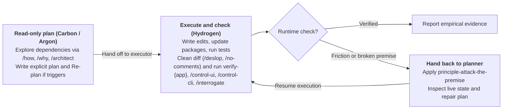
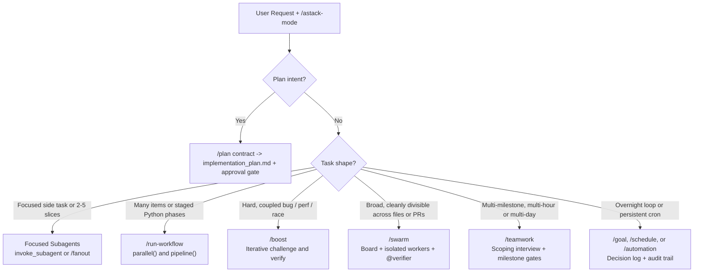

# AStack Architecture & Antigravity Mode Integration

**Author & Maintainer:** **João Machete** ([`@jmxt3`](https://github.com/jmxt3))  
**Foundations & Inspiration:** Built on **Lauren Tan (`@poteto`)**'s [`pstack`](https://github.com/cursor/plugins/tree/main/pstack) (MIT License) and inspired by **Garry Tan (`@garrytan`)**'s [`gstack`](https://github.com/garrytan/gstack) (MIT License, conceptual inspiration with no code copied). See [CREDITS.md](../CREDITS.md).

AStack provides a verification-first engineering environment (Control Glass verification skills, materialized feature maps, engineering playbooks, and anti-slop discipline) built natively for **Google Antigravity**, pairing it with **Orchestrator** (dynamic bidirectional model routing), `Subagents`, all 16 native Antigravity slash commands ([`native-commands.md`](../skills/astack-mode/references/native-commands.md), including `/plan`, `/grill-me`, `/learn`, `/boost`, `/swarm`, `/teamwork`, `/run-workflow`, `/goal`, `/schedule`, `/automation`, `/browser`), and opt-in lifecycle hooks.

## Core Thesis: Trust Through the Environment

High-throughput agentic engineering does not come from reviewing thousands of unverified diffs by hand. It comes from encoding verification and engineering constraints into the environment so agents can prove correctness themselves before asking for attention.

### The 5-Layer Enforcement Hierarchy

When agents repeat a mistake, push the fix as high up this hierarchy as possible:

| Layer | Strength | Mechanism in AStack / Antigravity |
|---|---|---|
| 1. Codebase & Architecture | Strongest | Data structures, module boundaries, single paved path (`principle-type-system-discipline`, `principle-model-the-domain`, `/correct`). Make the bad thing unrepresentable. |
| 2. Static Analysis & Tests | Strong | TypeScript strictness, linters, CI checks whose error names the fix, TLA+ models (`/statechart`, `/create-formal-verification-skill`), `/tdd`. |
| 3. Rules & Lifecycle Hooks | Medium | Always-on/triggered rules ([`rules/astack-orchestration.md`](../rules/astack-orchestration.md)) and opt-in [`hooks.json`](../hooks.json) (`PreToolUse` destructive command gate, `Stop` verify reminder). |
| 4. Skills & Playbooks | Situational | `/astack-mode` router, 23 playbooks, 24 named principles, `/how`, `/why`, `/architect`, `/arena`, `/interrogate`, `/deslop`, `/no-comments`. |
| 5. Human Review | Weakest | Reserved for design taste, product tradeoffs, and high-risk irreversible actions, assisted by `/teach`, `/ketchup`, and `/show-me-your-work`. |

## Control Glass & Verification Infrastructure

AStack bundles ready-to-use verification skills plus repo-specific generators:

- **Live UI Verification ([`control-ui`](../skills/control-ui/SKILL.md))**: Drives web, Electron, and browser apps through Antigravity's `browser` subagent and `chrome-devtools-mcp`, starts dev servers cleanly (`IsDaemon: true`), verifies console/network/DOM state, collects traces/screenshots, and tears down processes via `manage_task`.
- **CLI / TUI / Daemon Verification ([`control-cli`](../skills/control-cli/SKILL.md))**: Exercises commands against isolated temp directories and fixtures, checks exit codes and stdout/stderr contracts, and cleans up background processes.
- **Materialized Memory (`verify-<app>` + `features/`)**: [`/create-verification-skill`](../skills/create-verification-skill/SKILL.md) interviews the repository and generates `.agents/skills/verify-<app>/` with a `features/` sitemap so any future agent can map vague bug reports to exact user flows and proof checks. [`/maintain-verification-skill`](../skills/maintain-verification-skill/SKILL.md) keeps it accurate as the app evolves.
- **Post-Cleanup Hygiene ([`deslop`](../skills/deslop/SKILL.md) + [`no-comments`](../skills/no-comments/SKILL.md))**: Inlines single-caller indirection, removes narrating comments and unsupported defensive guards, runs adversarial comment review via `comment-sicko`, and re-verifies afterward.
- **Formal & Statechart Verification ([`statechart`](../skills/statechart/SKILL.md))**: Cross-platform Node 22+ TypeScript runner (`statechart.mjs`) converting TLA+ / TLC checks into Mermaid statecharts and bug-path traces.

## Dynamic Bidirectional Model Routing (Orchestrator)

Traditional static model routers guess task difficulty from the first prompt and lock the entire session onto one model. Antigravity's **Orchestrator** performs dynamic bidirectional model routing within a single session or trajectory between a frontier reasoning planner and the fast execution model [Gemini 4 Hydrogen](https://blog.google/innovation-and-ai/models-and-research/gemini-models/introducing-gemini-4-hydrogen/) ([Gemini 4 Hydrogen in Google Antigravity](https://antigravity.google/blog/gemini-4-hydrogen-in-google-antigravity/)):

- **Orchestrator (Carbon)** (**Google AI Ultra**): Pairs [Gemini 4 Carbon](https://antigravity.google/blog/gemini-4-carbon-in-google-antigravity) as the deep long-horizon planner with Gemini 4 Hydrogen for high-speed execution.
- **Orchestrator (Argon)** (**Google AI Pro** and **Google AI Ultra**): Pairs Gemini 4 Argon as the frontier planner with Gemini 4 Hydrogen for high-speed execution.

| Orchestrator phase | What Antigravity does | How AStack strengthens the hand-off |
|---|---|---|
| **Read-only frontier planning (Carbon / Argon)** | Explores dependencies, resolves ambiguities, and writes an explicit plan with re-planning triggers | [`/how`](../skills/how/SKILL.md), [`/why`](../skills/why/SKILL.md), `/grill-me`, [`/architect`](../skills/architect/SKILL.md), and `principle-model-the-domain` settle boundaries and data shapes upfront so the executor never guesses architecture mid-edit. |
| **High-speed execution (Hydrogen)** | Writes code edits, updates packages, and runs builds and tests | Playbook checklists, [`/tdd`](../skills/tdd/SKILL.md), [`/deslop`](../skills/deslop/SKILL.md), [`/no-comments`](../skills/no-comments/SKILL.md), [`/interrogate`](../skills/interrogate/SKILL.md), [`/control-ui`](../skills/control-ui/SKILL.md), [`/control-cli`](../skills/control-cli/SKILL.md), and `verify-<app>` turn "done" into a deterministic runtime check. |
| **Bidirectional friction recovery (Hydrogen back to planner)** | Hands control back to Carbon or Argon when execution hits roadblocks | Objective Control Glass failures and [`principle-attack-the-premise`](../skills/principle-attack-the-premise/SKILL.md) halt blind retry loops after repeated gate failures so the planner inspects live state and repairs the plan. |

AStack preserves bidirectional routing by omitting hardcoded model overrides (`Model: "inherit"` by default on `invoke_subagent` and unset `model` on `swarm{action: "add"}`). AStack reserves evergreen `flash` aliases for high-volume read-only sweeps and uses `swarm{action: "models"}` to discover distinct live model families only when [`/arena`](../skills/arena/SKILL.md) runs cross-family bakeoffs. In the Antigravity CLI, `/effort` (interactive timeline gauge across `low`..`max` on adjustable models, plus `agy --effort <level>` and `agy -p "/effort"`), `/usage` (`/quota`), and `/context` provide runtime inspection and tuning alongside fixed-budget dynamic **Orchestrator**.

## Antigravity Orchestration & Autonomy Decision Matrix

`/astack-mode` routes each task along three axes: native command intent ([`native-commands.md`](../skills/astack-mode/references/native-commands.md)), engineering playbook plus principle rigor, and execution mode. Short follow-ups stay sticky on the active playbook until `"new task"` resets classification or an explicit slash command takes over.

| Antigravity Mode | Engagement | Use When | AStack Pairing | Workspace & Isolation |
|---|---|---|---|---|
| **Subagents & `/fanout`** | `run` (`invoke_subagent`) | Self-contained research, browser check (`/browser`), comment pass (`comment-sicko`), or 2-5 slices/races | `/how`, `/why`, `/fanout`, `/arena`, `/interrogate`, `/reflect`, `/recall` | `Workspace: "inherit"` for readers; `"share"` or `"branch"` for writers |
| **`/run-workflow`** | `run` (`run_workflow` + `run-workflow`) | Same check or refactor across many files, or staged multi-phase Python pipelines (Pro & Ultra) | `/fanout`, [`swarm-coordination.md`](../skills/astack-mode/references/swarm-coordination.md) | Managed per-item workflow workers |
| **`/boost`** | `recommend` | Problem is **hard rather than broad**: coupled debugging, race conditions, algorithmic optimization (Paid plans) | `bug-fix`, `perf-issue`, `hillclimb`, `runtime-forensics`, `/tdd`, `/benchmark-checklist`, `/statechart` | Single focused thread with multi-round challenge/fix/verify |
| **`/swarm`** | `run` (`swarm` + `swarm` skill) | Work is **broad and divides cleanly** across modules, test suites, or PRs needing board coordination (Pro & Ultra) | `autopilot-full`, `autopilot-stack`, [`swarm-coordination.md`](../skills/astack-mode/references/swarm-coordination.md) | `workspace: "share"` / `"branch"` for writers; `inherit` for `@verifier` and `@monitor` |
| **`/teamwork`** | `recommend` | **Long-horizon, multi-milestone** migrations, rewrites, or simulations spanning hours or days (Paid plans) | `orchestrate`, `multi-phase-plan`, `/architect`, `/interrogate`, `/show-me-your-work` | Dedicated project directory + milestone audit gates |
| **`/goal`, `/schedule`, `/automation`** | `recommend` / `run` / `load` | `/goal` for uninterrupted completion; `/schedule` for in-session timers/crons; `/automation` (App only, `CRON_TZ=`) for persistent background triggers | `autonomous-run`, `/figure-it-out`, `/show-me-your-work` (`decisions.tsv`), `/ketchup` | Isolated git worktree (`pause-safely`) or App sidecar (`sidecar.json`) |

### Dedicated Antigravity UI Surfacing

When AStack runs native capabilities behind the scenes, each mode surfaces its dedicated Antigravity UI entrypoint per [`native-commands.md`](../skills/astack-mode/references/native-commands.md):

- **`/swarm`**: Loads `swarm` plus `swarm_pane` (maintaining `.system_generated/swarm/plan.json`) and ends both kickoff and completion (after `[done] 
`) with the exact `open_board` string on its own line so you can open the **Swarm** UI (**Overview**, **Board**, **Members**, **Graph**) in App or `/swarm board` (`Alt+S`) in CLI.
- **`/generative_ui` (App only)**: Writes `<artifact-dir>/<name>.html` via `write_file` (`UserFacing: true`, `RequestFeedback: false`), embeds compact widgets (`<= 450px`) inline with `<agent-embed>`, and points to the **Artifact card** (**Overview > Artifacts**) for Side-Panel viewing (Mermaid fallback in CLI).
- **Workflows, Subagents, Browser, Automations, Reviews & CLI Panels**: Surfaces the **Workflow step card** (`phase()` / clickable `role` cards) for `/run-workflow`, **Overview > Subagents** or CLI `/agents` (`Alt+J` / `Ctrl+K`) and the **Built-in Side-Panel Browser** for subagents and `/browser`, `[Open Automations Dashboard](sidecar://dashboard)` with `display_name` for `/automation`, **Overview > Background Tasks** / **Goals** or CLI `/tasks` for `/schedule` and `/goal`, `customization://<install-dir>` / `<plugin-card>` / `sidecar://` pills for plugins and UI sidecars, and **Overview > Review** or CLI `/diff` when handing back code for review.

### Customization Precedence, Namespacing & Why `/fanout` Replaces `/swarm`

In Antigravity's customization discovery and precedence order (**Workspace Project** > **Declared Configurations** > **Global `~/.gemini/config/`** > **Built-in Customizations** > **Global Declared Configurations**), installed plugin customizations follow declared-configuration priority and collide cleanly via `<plugin>:<skill>` namespacing (for example `astack:tdd`), while plugin MCP servers are namespaced as `<plugin>_<server>`.

To avoid ever shadowing a native slash command or built-in skill:

- AStack keeps slice fan-out under **`skills/fanout`** (`/fanout`), letting `/fanout` handle lightweight `invoke_subagent` fan-out matrices and escalate cleanly to native `/swarm` when workers need a shared message board or dedicated `@verifier`.
- [`validate-astack.mjs`](../scripts/validate-astack.mjs) and [`catalog.mjs`](../scripts/catalog.mjs) enforce `RESERVED_SKILL_NAMES` against all 16 native slash commands and the 16 built-in reserved names.
- **Context budget (`disable-model-invocation: true`)**: Antigravity preloads only `name` and `description` for auto-invocable skills. AStack sets `disable-model-invocation: true` on `33` manual-only/reference skills (`24` `principle-*` skills plus `9` explicit slash entrypoints listed in [`catalog.json`](../scripts/catalog.json)), keeping `28` auto-invocable workflow skills lean in the session index.

See [`skills/astack-mode/references/swarm-coordination.md`](../skills/astack-mode/references/swarm-coordination.md) for concrete `swarm` (`title`, `add`, `workspace`, `@verifier`, `@monitor`, cleanup) patterns.

## Opt-In Lifecycle Hooks (`hooks.json`)

[`hooks.json`](../hooks.json) ships two lightweight Node 22+ lifecycle hooks **disabled by default (`"enabled": false`)** so installing AStack introduces zero unexpected friction:

1. **`astack-irreversible-guard` (`PreToolUse` on `run_command`)**: Inspects shell strings (including unwrapped nested `sh -c`, `bash -c`, `pwsh -Command`, `cmd /c`, and `eval` calls, scoped SQL DB execution vs read-only searches, and trunk refspec pushes such as `+main`, `:main`, and `--delete main`). Returns `{"decision": "force_ask"}` interactively or `{"decision": "deny"}` under `CI=true` / `NON_INTERACTIVE=1`. Implemented in [`scripts/hooks/irreversible-guard.mjs`](../scripts/hooks/irreversible-guard.mjs).
2. **`astack-verify-reminder` (`Stop`)**: When enabled and `ASTACK_REQUIRE_VERIFY=1` is set in the environment, nudges once (`{"decision": "continue"}`) if uncommitted non-markdown changes exist on a normal `NO_TOOL_CALL` stop, strictly honoring `continuationActive` to prevent loops. Implemented in [`scripts/hooks/verify-reminder.mjs`](../scripts/hooks/verify-reminder.mjs).

## Outer Loop Automations (`benny`)

AStack includes [`docs/automations/benny/`](./automations/benny/README.md), a dormant two-stage automation pack (triage plus reproduce-and-fix) adapted to `.agents/automations/benny/`, Antigravity `/automation` (`sidecar.json` + `CRON_TZ=`), **Remote Agents** (`agy --remote-agent`), headless `agy -p` runners, `/schedule`, `control-ui` and `control-cli`, and fail-closed Slack thread invariants.

## Lineage: What AStack Kept, Adapted, and Built Natively

| Lineage / Concept | AStack Antigravity Equivalent | Notes |
|---|---|---|
| Plugin manifest and lifecycle hooks | [`plugin.json`](../plugin.json) + opt-in [`hooks.json`](../hooks.json) | Verified by [`validate-astack.mjs`](../scripts/validate-astack.mjs) and `agy plugin validate --strict` |
| Mode router, help, and repo setup | [`/astack-mode`](../skills/astack-mode/SKILL.md), [`/astack-help`](../skills/astack-help/SKILL.md), [`/setup-astack`](../skills/setup-astack/SKILL.md) | `SKILL.md` allows `name`, `description`, `disable-model-invocation` (`33` manual-only / `28` auto-invocable), `license`, `compatibility`; body `<= 24,000` bytes; `astack-agent` inherits context and `comment-sicko` sets `inheritCustomizations: false` |
| Slice fan-out vs coordinated board | [`/fanout`](../skills/fanout/SKILL.md) (`invoke_subagent`) + built-in `/swarm` (`swarm`, `post_message`, `read_board`, `swarm_wait`) | Dedicated `/fanout` skill prevents shadowing Antigravity's built-in `/swarm` |
| Model routing and cross-family diversity | `Model: "inherit"` default (UI picker and **Orchestrator** bidirectional routing), `Model: "flash"` for broad `research`/`browser` sweeps, live `swarm{action: "models", all: true}` discovery, optional `astack-models.md` | Cross-family `/arena` and `/interrogate` discover healthy `quota_remaining` live |
| Workspace and global customizations | `.agents/skills/` and `~/.gemini/config/skills/`; `.agents/rules/` and `~/.gemini/config/rules/` | Global skills live under `~/.gemini/config/skills/` |
| Structured multi-choice prompts & `/plan` | `ask_question` (`is_multi_select: true`, unnumbered options, `(Recommended)` first, built-in `"Other (write your answer)"`) + [`plan-contract.md`](../skills/astack-mode/references/plan-contract.md) | Supports both direct `implementation_plan.md` writes and Orchestrator Plan Mode handoffs with inline comments and **Proceed** |
| Conversation transcripts | `<appDataDir>/brain/<conversation-id>/.system_generated/logs/transcript.jsonl` | Paired with `transcript_full.jsonl` when `truncated_fields` is present |
| Verification harnesses, watch & outer loop | [`/control-ui`](../skills/control-ui/SKILL.md), [`/control-cli`](../skills/control-cli/SKILL.md), [`/deslop`](../skills/deslop/SKILL.md), repo `.agents/skills/verify-<app>/`, [`upstream-watch.mjs`](../scripts/upstream-watch.mjs), [`docs/automations/benny/`](./automations/benny/README.md) | Concrete runtime proof before reporting done |
