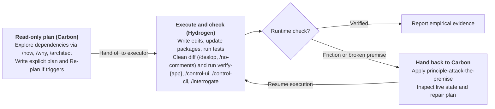
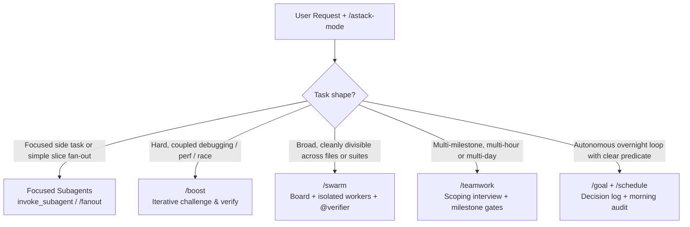

# AStack Architecture & Antigravity Mode Integration

**Original `pstack` & Michelin Kitchen thesis:** **Lauren Tan (`@poteto`)** ([`cursor/plugins/pstack`](https://github.com/cursor/plugins/tree/main/pstack), MIT License).  
**Native Antigravity port (`astack`):** **João Machete**.

AStack ports Lauren Tan's engineering environment, including verification skills ("Control Glass"), materialized feature maps, engineering playbooks, and anti-slop discipline, into **Google Antigravity**, pairing it natively with **Orchestrator** (dynamic bidirectional model routing), `Subagents`, `/boost`, `/swarm`, `/teamwork`, `/goal`, `/schedule`, and opt-in lifecycle hooks.

## Core Thesis: Trust Through the Environment

High-throughput agentic engineering does not come from reviewing thousands of unverified diffs by hand. It comes from encoding verification and engineering constraints into the environment so agents can prove correctness themselves before asking for attention.

### The 5-Layer Enforcement Hierarchy

When agents repeat a mistake, push the fix as high up this hierarchy as possible:

| Layer | Strength | Mechanism in AStack / Antigravity |
|---|---|---|
| 1. Codebase & Architecture | Strongest | Data structures, module boundaries, single paved path (`principle-type-system-discipline`, `principle-model-the-domain`, `/correct`). Make the bad thing unrepresentable. |
| 2. Static Analysis & Tests | Strong | TypeScript strictness, linters, CI checks whose error names the fix, TLA+ models (`/statechart`, `/create-formal-verification-skill`), `/tdd`. |
| 3. Rules & Lifecycle Hooks | Medium | Always-on/triggered rules ([`rules/astack-orchestration.md`](../rules/astack-orchestration.md)) and opt-in [`hooks.json`](../hooks.json) (`PreToolUse` destructive command gate, `Stop` verify reminder). |
| 4. Skills & Playbooks | Situational | `/astack-mode` router, 23 playbooks, 24 named principles, `/how`, `/why`, `/architect`, `/arena`, `/interrogate`, `/deslop`, `/no-comments`. |
| 5. Human Review | Weakest | Reserved for design taste, product tradeoffs, and high-risk irreversible actions — assisted by `/teach`, `/ketchup`, and `/show-me-your-work`. |

## Control Glass & Verification Infrastructure

AStack bundles ready-to-use verification skills plus repo-specific generators:

- **Live UI Verification ([`control-ui`](../skills/control-ui/SKILL.md))**: Drives web, Electron, and browser apps through Antigravity's `browser` subagent and `chrome-devtools-mcp`, starts dev servers cleanly (`IsDaemon: true`), verifies console/network/DOM state, collects traces/screenshots, and tears down processes via `manage_task`.
- **CLI / TUI / Daemon Verification ([`control-cli`](../skills/control-cli/SKILL.md))**: Exercises commands against isolated temp directories and fixtures, checks exit codes and stdout/stderr contracts, and cleans up background processes.
- **Materialized Memory (`verify-<app>` + `features/`)**: [`/create-verification-skill`](../skills/create-verification-skill/SKILL.md) interviews the repository and generates `.agents/skills/verify-<app>/` with a `features/` sitemap so any future agent can map vague bug reports to exact user flows and proof checks. [`/maintain-verification-skill`](../skills/maintain-verification-skill/SKILL.md) keeps it accurate as the app evolves.
- **Post-Cleanup Hygiene ([`deslop`](../skills/deslop/SKILL.md) + [`no-comments`](../skills/no-comments/SKILL.md))**: Inlines single-caller indirection, removes narrating comments and unsupported defensive guards, runs adversarial comment review via `comment-sicko`, and re-verifies afterward.
- **Formal & Statechart Verification ([`statechart`](../skills/statechart/SKILL.md))**: Cross-platform Node 22+ TypeScript runner (`statechart.mjs`) converting TLA+ / TLC checks into Mermaid statecharts and bug-path traces.

## Dynamic Bidirectional Model Routing (Orchestrator)

Traditional static model routers guess task difficulty from the first prompt and lock the entire session onto one model. Antigravity's **Orchestrator** routes dynamically within a single session or trajectory between a frontier reasoning model such as [Gemini 4 Carbon](https://antigravity.google/blog/gemini-4-carbon-in-google-antigravity) and a fast execution model such as [Gemini 4 Hydrogen](https://blog.google/innovation-and-ai/models-and-research/gemini-models/introducing-gemini-4-hydrogen/) ([Gemini 4 Hydrogen in Google Antigravity](https://antigravity.google/blog/gemini-4-hydrogen-in-google-antigravity/)).

| Orchestrator phase | What Antigravity does | How AStack strengthens the hand-off |
|---|---|---|
| **Read-only frontier planning (Carbon)** | Explores dependencies, resolves ambiguities, and writes an explicit plan with re-planning triggers | [`/how`](../skills/how/SKILL.md), [`/why`](../skills/why/SKILL.md), `/grill-me`, [`/architect`](../skills/architect/SKILL.md), and `principle-model-the-domain` settle boundaries and data shapes upfront so the executor never guesses architecture mid-edit. |
| **High-speed execution (Hydrogen)** | Writes code edits, updates packages, and runs builds and tests | Playbook checklists, [`/tdd`](../skills/tdd/SKILL.md), [`/deslop`](../skills/deslop/SKILL.md), [`/no-comments`](../skills/no-comments/SKILL.md), [`/interrogate`](../skills/interrogate/SKILL.md), [`/control-ui`](../skills/control-ui/SKILL.md), [`/control-cli`](../skills/control-cli/SKILL.md), and `verify-<app>` turn "done" into a deterministic runtime check. |
| **Bidirectional friction recovery (Hydrogen back to Carbon)** | Hands control back to the frontier planner when execution hits roadblocks | Objective Control Glass failures and [`principle-attack-the-premise`](../skills/principle-attack-the-premise/SKILL.md) halt blind retry loops after repeated gate failures so Carbon inspects live state and repairs the plan. |

AStack preserves bidirectional routing by omitting hardcoded model overrides (`Model: "inherit"` by default on `invoke_subagent` and unset `model` on `swarm{action: "add"}`). AStack reserves evergreen `flash` aliases for high-volume read-only sweeps and uses `swarm{action: "models"}` to discover distinct live model families only when [`/arena`](../skills/arena/SKILL.md) runs cross-family bakeoffs.

## Antigravity 5-Mode Decision Matrix

`/astack-mode` routes each task along two axes: **what engineering workflow it needs** (the 23 playbooks + 24 principles) and **which Antigravity execution mode matches its shape**.

| Antigravity Mode | Use When | AStack Pairing | Workspace & Isolation |
|---|---|---|---|
| **Subagents** (`invoke_subagent` / `/fanout`) | Self-contained research, browser check, test slice, independent check matrix, or declared race arms | `/how`, `/why`, `/fanout`, `/arena`, `/interrogate`, `/reflect`, `/recall` | `Workspace: "inherit"` for readers; `"share"` or `"branch"` for writers |
| **`/boost`** | Problem is **hard rather than broad**: root-cause debugging, race conditions, algorithmic perf, tightly coupled refactors | `bug-fix`, `perf-issue`, `hillclimb`, `runtime-forensics`, `/tdd`, `/benchmark-checklist`, `/statechart` | Single focused thread with multi-round challenge/fix/verify |
| **`/swarm`** | Work is **broad and divides cleanly** across files, packages, test suites, or research lenses needing live coordination | `autopilot-full`, `autopilot-stack`, [`swarm-coordination.md`](../skills/astack-mode/references/swarm-coordination.md) | `workspace: "share"` for concurrent writers, `inherit` for `@verifier` (`control-ui`/`control-cli` + `deslop`) and optional `@monitor` |
| **`/teamwork`** | **Long-horizon, multi-milestone** migrations, rewrites, or simulations spanning hours/days | `orchestrate`, `multi-phase-plan`, `/architect`, `/interrogate`, `/show-me-your-work` | Dedicated project directory + milestone audit gates |
| **`/goal` (+ `/schedule`)** | Sustained autonomous iteration until a concrete checkable finish predicate holds | `autonomous-run`, `/figure-it-out`, `/show-me-your-work` (`decisions.tsv`), `/ketchup` | Isolated git worktree; pause safely on interruption (`pause-safely`) |

### Why `/fanout` Instead of `/swarm`?

In Antigravity's customization loading order (**Workspace -> Global -> Plugin -> Built-in**), **plugin skills have higher precedence than built-in skills of the same name**. Shipping a plugin skill at `skills/swarm` would shadow Antigravity's built-in multi-agent `/swarm` board skill.

Therefore, AStack explicitly renames `pstack`'s upstream `skills/swarm` slice runner to **`skills/fanout`** (`/fanout`). This preserves Antigravity's built-in `/swarm` cleanly while letting `/fanout` handle lightweight `invoke_subagent` fan-out matrices and seamlessly escalate to native `/swarm` whenever workers need a shared message board or dedicated `@verifier`.

See [`skills/astack-mode/references/swarm-coordination.md`](../skills/astack-mode/references/swarm-coordination.md) for concrete `swarm` (`title`, `add`, `workspace`, `@verifier`, `@monitor`, cleanup) patterns.

## Opt-In Lifecycle Hooks (`hooks.json`)

[`hooks.json`](../hooks.json) ships two lightweight Node 22+ lifecycle hooks **disabled by default (`"enabled": false`)** so installing AStack introduces zero unexpected friction:

1. **`astack-irreversible-guard` (`PreToolUse` on `run_command`)**: Intercepts potentially irreversible commands (`git push --force`, `git reset --hard`, recursive root deletes, `DROP TABLE`/`DATABASE`, prod destroys/deploys) with `{"decision": "force_ask"}` so confirmation ignores cached "Always Allow" approvals. Implemented in [`scripts/hooks/irreversible-guard.mjs`](../scripts/hooks/irreversible-guard.mjs).
2. **`astack-verify-reminder` (`Stop`)**: When enabled and `ASTACK_REQUIRE_VERIFY=1` is set in the environment, nudges once (`{"decision": "continue"}`) if uncommitted non-markdown changes exist on a normal `NO_TOOL_CALL` stop, strictly honoring `continuationActive` to prevent loops. Implemented in [`scripts/hooks/verify-reminder.mjs`](../scripts/hooks/verify-reminder.mjs).

## Outer Loop Automations (`benny`)

AStack includes [`docs/automations/benny/`](./automations/benny/README.md), a dormant two-stage automation pack (triage plus reproduce-and-fix) adapted to `.agents/automations/benny/`, Antigravity `/schedule` and `agy -p` runners, `control-ui` and `control-cli`, and fail-closed Slack thread invariants.

## Upstream pstack to AStack Port Map

| Upstream pstack Concept | AStack Antigravity Equivalent | Notes |
|---|---|---|
| Plugin manifest and lifecycle hooks | [`plugin.json`](../plugin.json) + opt-in [`hooks.json`](../hooks.json) | Verified by [`validate-astack.mjs`](../scripts/validate-astack.mjs) and `agy plugin validate --strict` |
| Mode router, help, and repo setup | [`/astack-mode`](../skills/astack-mode/SKILL.md), [`/astack-help`](../skills/astack-help/SKILL.md), [`/setup-astack`](../skills/setup-astack/SKILL.md) | `SKILL.md` frontmatter restricted to `name` and `description`; body `<= 24,000` bytes |
| Slice fan-out vs coordinated board | [`/fanout`](../skills/fanout/SKILL.md) (`invoke_subagent`) + built-in `/swarm` (`swarm`, `post_message`, `read_board`, `swarm_wait`) | Renaming `skills/swarm` to `skills/fanout` prevents Plugin priority from shadowing Built-in `/swarm` |
| Model routing and cross-family diversity | `Model: "inherit"` default (UI picker and **Orchestrator** bidirectional routing), `Model: "flash"` for broad `research`/`browser` sweeps, live `swarm{action: "models", all: true}` discovery, optional `astack-models.md` | Cross-family `/arena` and `/interrogate` discover healthy `quota_remaining` live |
| Workspace and global customizations | `.agents/skills/` and `~/.gemini/config/skills/`; `.agents/rules/` and `~/.gemini/config/rules/` | Global skills live under `~/.gemini/config/skills/` |
| Structured multi-choice prompts | `ask_question` (`is_multi_select: true`, `(Recommended)` prefix on default option) | Used by [`/automate-me`](../skills/automate-me/SKILL.md) and [`/setup-astack`](../skills/setup-astack/SKILL.md) |
| Conversation transcripts | `<appDataDir>/brain/<conversation-id>/.system_generated/logs/transcript.jsonl` | Paired with `transcript_full.jsonl` when `truncated_fields` is present |
| Verification harnesses and outer loop | [`/control-ui`](../skills/control-ui/SKILL.md), [`/control-cli`](../skills/control-cli/SKILL.md), [`/deslop`](../skills/deslop/SKILL.md), repo `.agents/skills/verify-<app>/`, [`docs/automations/benny/`](./automations/benny/README.md) | Concrete runtime proof before reporting done |
