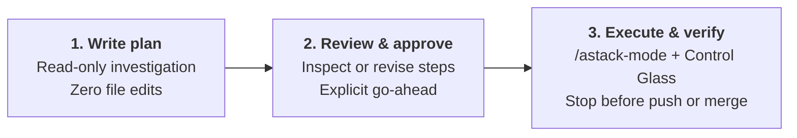
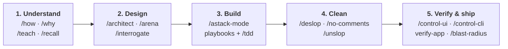

# AStack User Guide: Quickstart, Daily Workflow & Mastery

**AStack** (`astack`) adapts Lauren Tan's (`@poteto`) verification-first `pstack` workflows natively for **Google Antigravity**. Instead of reviewing long unverified diffs by hand, you state **what outcome you want and how to prove it works**, while AStack matches a rigorous playbook, coordinates Antigravity's subagents and multi-agent modes, cleans the diff, and proves behavior on the running app before reporting done.

> **Credits & Attribution**  
> **Original Plugin (`pstack`):** Created by **Lauren Tan** (`@poteto`) in [`cursor/plugins/pstack`](https://github.com/cursor/plugins/tree/main/pstack) (MIT License, baseline `v0.15.36`).  
> **Antigravity Port (`astack`):** Adapted and engineered for Google Antigravity by **João Machete** ([`jmxt3/astack`](https://github.com/jmxt3/astack)).

**Contents:**
- [Part 1: Start using AStack in 1 minute](#part-1-start-using-astack-in-1-minute)
- [Part 2: Plan-first workflow (write a plan, approve, then execute)](#part-2-plan-first-workflow-write-a-plan-approve-then-execute)
- [Part 3: Day-to-day 5-stage workflow](#part-3-day-to-day-5-stage-workflow)
- [Part 4: Multi-agent modes and power moves](#part-4-multi-agent-modes-and-power-moves)

---

## Part 1: Start Using AStack in 1 Minute

### Step 1: Install the Plugin

From GitHub:

```bash
agy plugin install https://github.com/jmxt3/astack
agy plugin list --json
```

If you are updating from a local clone (for example `./astack`) on Windows while Antigravity is running, run `agy plugin uninstall astack` before `agy plugin install .`.

### Step 2: Run `/setup-astack` Once in Your Project

Open your project workspace and run:

```text
/setup-astack
```

Select the **`(Recommended)`** option when prompted so [`/setup-astack`](../skills/setup-astack/SKILL.md) teaches agents how to launch and verify your app automatically.

> [!TIP]
> AStack works out of the box with **any model on any Antigravity plan**—no model config or chat restart needed. Broad read-only sweeps use `flash` automatically, `/arena` checks the models available on your account live, optional `flash`/`pro` role overrides are available in [Make it yours](./guide/09-make-it-yours.md), and if your plan includes `Orchestrator` (Ultra), AStack inherits it automatically too.

### Step 3: Run Tasks With `/astack-mode`

Describe **what you want** and **how to check it works** in plain English:

```text
/astack-mode add a --json flag to the export command. keep plain text output byte-identical, prove both outputs on the sample fixture, and don't push yet.
```

`/astack-mode` picks the right playbook from its 23 playbooks, writes and cleans the code, and proves behavior on the real surface before finishing.

Unsure which skill fits? Ask [`/astack-help`](../skills/astack-help/SKILL.md) without spending execution tokens yet:

```text
/astack-help which skill should I use to review this branch before opening a PR?
```

---

## Part 2: Plan-first workflow (write a plan, approve, then execute)

Both Antigravity (`/plan` and **Orchestrator**) and AStack pause before touching project files whenever your prompt asks for plan approval first or runs a plan-only playbook:



### Step 1: Write a plan without changing code

Pick the prompt that matches the size of the work:

1. **Everyday feature or bug fix (`/plan` + `/astack-mode`):** Pairs Antigravity's `/plan` gate with AStack's read-only [`investigation.md`](../skills/astack-mode/playbooks/investigation.md) path:
   ```text
   /plan /astack-mode <task or bug>. Investigate the codebase, write a step-by-step implementation and verification plan, and stop for my approval before editing any files.
   ```
2. **Unclear requirements or edge cases ([`/interrogate`](../skills/interrogate/SKILL.md) or `/grill-me`):** Audits real callers and failure cases first, then asks only what code could not settle (pair with Antigravity's `/grill-me` for a structured alignment interview):
   ```text
   /interrogate <idea>. Check the codebase first, surface hidden assumptions and edge cases, and align with me before writing a plan or changing code.
   ```
3. **API, module boundary, or architecture change ([`/architect`](../skills/architect/SKILL.md) with checkpoint):** By default `/architect` moves straight from design into code unless you pass `with checkpoint`:
   ```text
   /architect <feature or API>. With checkpoint. Compare candidate designs, screen for red flags, write the type sketch and rationale, and stop for my approval before implementing.
   ```
4. **Multi-PR feature, refactor, or migration ([`multi-phase-plan.md`](../skills/astack-mode/playbooks/multi-phase-plan.md)):** Makes the checklist the deliverable, validates it with [`check-plan.mjs`](../skills/astack-mode/scripts/check-plan.mjs), and edits zero product files (pair with `/teamwork` when you want approval gates after every milestone):
   ```text
   /astack-mode Turn <goal> into a plan in docs/<name>-plan.md with small verifiable units and live verification steps. Do not implement. Stop for my approval.
   ```

### Step 2: Review, revise, or sharpen

Ask for revisions directly in chat before giving the go-ahead:

```text
Update step 2 to use <X> instead of <Y>, keep <Z> out of scope, and show me the revised plan before implementing.
```

Three zero-execution skills help refine prompts and check understanding before you spend execution turns:

- [`/sharpen`](../skills/sharpen/SKILL.md): rewrites a rough prompt deeper without running the task.
- [`/in-your-own-words`](../skills/in-your-own-words/SKILL.md): restates what the agent thinks your goal is so you catch misreadings early.
- [`/astack-help`](../skills/astack-help/SKILL.md): recommends the right skill and returns a copyable prompt without starting work.

### Step 3: Execute the approved plan through AStack

Once you approve the plan, execute it through AStack while keeping final git push and merge decisions in your hands:

- **Single-branch execution** (prepend `/boost` for hard race conditions or coupled defects):
  ```text
  /astack-mode Approved. Execute the plan above, prove it works end-to-end, run /deslop and /no-comments, and stop before git push so I can review the diff.
  ```
- **Parallel or stacked multi-PR execution from a saved plan file:** Use [`autopilot-stack.md`](../skills/astack-mode/playbooks/autopilot-stack.md) instead of [`autopilot-full.md`](../skills/astack-mode/playbooks/autopilot-full.md). `autopilot-stack` builds and verifies every PR in the plan, then stops and hands them back without merging:
  ```text
  /swarm /astack-mode Approved. Execute docs/<name>-plan.md with the autopilot-stack playbook. Stop once every unit is verified and wait for my review before pushing or merging.
  ```

---

## Part 3: Day-to-day 5-stage workflow

Most engineering tasks flow naturally through five stages. You don't have to memorize or chain these commands manually. `/astack-mode` invokes them automatically when needed, and knowing each stage lets you call any skill directly when you want focused control.



### Stage 1: Understand Before Changing Code

Editing unfamiliar code causes regressions. Use read-only exploration first:

1. **Trace how code works now:** `/how` ([SKILL.md](../skills/how/SKILL.md)) gives an onboarding-grade mental model of runtime flow, ownership, and gotchas.
   ```text
   /how do background job retries avoid running twice?
   ```
2. **Dig up why a rule or branch exists:** `/why` ([SKILL.md](../skills/why/SKILL.md)) queries git history, PRs, and connected MCPs (issues, docs, team chat, logs, error trackers, analytics) in parallel and separates facts from inference.
   ```text
   /why is the retry limit hardcoded to 5? does that constraint still hold?
   ```
3. **Force a convincing explanation:** `/teach` ([SKILL.md](../skills/teach/SKILL.md)) weaves `/how` and `/why` into a plain-language argument with diagrams.
   ```text
   /teach me how this PR changes retries and convince me it fixes the root cause.
   ```
4. **Rebuild context across chats:** `/recall` ([SKILL.md](../skills/recall/SKILL.md)) mines your recent Antigravity transcripts and live repo/PR state so a fresh chat doesn't repeat old dead ends.
5. **Run a pure read-only investigation:**
   ```text
   /astack-mode investigate why workers stall under load. give me confirmed facts, files read, and falsifiable hypotheses. don't change any code yet.
   ```

### Stage 2: Design Before Locking In Structure

One attempt locks in the first shape the model thinks of. For boundary-crossing work, force competition before committing to code:

- **Cross-boundary API & architecture design:** `/architect` ([SKILL.md](../skills/architect/SKILL.md)) grounds constraints in real callers, spawns parallel design candidates (caller usage first, data shape first), screens for Ousterhout design red flags, and synthesizes one clean architecture.
  ```text
  /architect design the webhook rate limiter across our API gateway. stop and show me the design before implementing.
  ```
- **Competitive multi-candidate bakeoff:** `/arena` ([SKILL.md](../skills/arena/SKILL.md)) runs 2–3 isolated implementations in parallel, screens them against the same empirical pass predicate, picks **one clean base**, and grafts 1–2 non-conflicting wins.
  ```text
  /arena solve the cache key invalidation bug in 3 isolated candidates and graft the cleanest solution.
  ```
- **Settle empirical questions with code, not debate:**
  ```text
  /astack-mode prototype two layouts for the filter bar in a scratch folder and show screenshots via /control-ui.
  ```

### Stage 3: Build With `/astack-mode`

[`/astack-mode`](../skills/astack-mode/SKILL.md) selects the matching playbook automatically from how you phrase your goal:

| Task Type | Copy-Pasteable Prompt Pattern | Playbook / Skill Triggered |
|---|---|---|
| **Bug fix (Web/UI)** | `/astack-mode <symptom> when clicking <flow>. repro first via /control-ui, fix the root cause, and prove with before/after DevTools output.` | `bug-fix` + [`control-ui`](../skills/control-ui/SKILL.md) |
| **Bug fix (CLI/API)** | `/astack-mode <command> fails with <error>. repro via /control-cli, add a failing test if cheap, fix root cause, and show failing-then-passing output.` | `bug-fix` + [`control-cli`](../skills/control-cli/SKILL.md) + [`tdd`](../skills/tdd/SKILL.md) |
| **New feature** | `/astack-mode add <behavior> starting from the domain data shape. keep <existing flow> unchanged and verify end-to-end.` | `feature` + `/architect` (if cross-boundary) |
| **Refactor** | `/astack-mode refactor <module> with zero behavior change. capture baseline output first and prove parity after.` | `refactoring` |
| **Measured perf** | `/astack-mode <operation> takes <X>ms on <fixture>. trace it, fix the measured bottleneck, and vet before/after numbers.` | `perf-issue` + [`benchmark-checklist`](../skills/benchmark-checklist/SKILL.md) |

> [!NOTE]
> When editing TypeScript (`.ts` / `.tsx`), explicitly mention `/typescript-best-practices` ([SKILL.md](../skills/typescript-best-practices/SKILL.md)) to enforce discriminated unions, `unknown` boundary parsing, and exhaustive matching. For cheap local failing-test-first iterations, run `/tdd` ([SKILL.md](../skills/tdd/SKILL.md)) directly.

### Stage 4: Clean the Diff Before Commit & Review

AStack separates code cleanup, comment removal, and prose cleanup into three specialized passes:

1. **`/deslop` ([SKILL.md](../skills/deslop/SKILL.md)) — Strip code bloat:** Inlines single-caller wrappers, deletes unsupported defensive fallbacks and dead compatibility layers, removes unrelated changes, and re-runs verification.
2. **`/no-comments` ([SKILL.md](../skills/no-comments/SKILL.md)) — Fresh-eyes comment & suppression audit:** Spawns [`comment-sicko`](../agents/comment-sicko.md) to delete narrating comments, flag workaround comments for root-cause fixes, and offer structural encodings (types/lints/tests) for claimed constraints.
3. **`/unslop` ([SKILL.md](../skills/unslop/SKILL.md)) & `/technical-writing` ([SKILL.md](../skills/technical-writing/SKILL.md)) — Tighten prose:** Removes AI writing tells, filler, long dashes, and mid-sentence colons from docs, READMEs, RFCs, PR descriptions, and commit messages.

### Stage 5: Verify on the Real Surface & Ship

"It compiles" or mocked unit tests alone are never accepted as proof:

- **Prove behavior live:** Use `.agents/skills/verify-<app>/`, [`/control-ui`](../skills/control-ui/SKILL.md) (browser/Electron via Antigravity's `browser` subagent + Chrome DevTools MCP), or [`/control-cli`](../skills/control-cli/SKILL.md) (isolated temp dirs, exit codes, stdout/stderr contracts, and background daemon cleanup).
- **Check hidden ripple effects:** Run `/blast-radius` ([SKILL.md](../skills/blast-radius/SKILL.md)) on small risky diffs to prove safety with real execution.
- **Adversarial pre-ship review:** Run `/interrogate` ([SKILL.md](../skills/interrogate/SKILL.md)) over a branch; only findings backed by a failing rerun survive.
- **Babysit and land PRs:**
  - `/astack-mode babysit pr <number> to green.`
  - `/astack-mode land the verified stack.`

---

## Part 4: Multi-agent modes and power moves

### 1. Pair `/astack-mode` With Antigravity's Native Execution Modes

The biggest leverage in Antigravity comes from matching **task shape** to the right execution mode:

| Problem Shape | Use This Command / Mode | Why It Wins |
|---|---|---|
| Single focused task | `/astack-mode <goal>` | Clean single-thread playbook execution on your active model without multi-worker overhead. |
| 2–5 independent read-only sweeps, test matrices, or file-disjoint edits | `/fanout` ([SKILL.md](../skills/fanout/SKILL.md)) | Fast subagent parallelism without spinning up a full message board. |
| **Hard, tightly coupled** bug, race condition, or perf bottleneck | `/boost /astack-mode <problem>` | Multi-round hypothesis challenge, fix, and empirical re-verification on shared code. |
| **Broad, divisible** work across multiple modules, packages, or PRs | `/swarm /astack-mode <goal>` | Live shared board, isolated worker workspaces, plus an independent `@verifier` gate. |
| Multi-milestone, multi-hour or multi-day migration | `/teamwork /astack-mode <goal>` | Upfront scoping interview plus milestone verification gates. |
| Unattended overnight run with a crisp pass/fail command | `/goal /astack-mode <goal + check command>` | Drives until the checkable predicate passes; logs every step via [`/show-me-your-work`](../skills/show-me-your-work/SKILL.md) (`decisions.tsv`). |

When returning from a long `/swarm`, `/teamwork`, or `/goal` run, catch up in seconds using [`/ketchup`](../skills/ketchup/SKILL.md) (plain-English summary + pending decisions) or [`/ketchup-video`](../skills/ketchup-video/SKILL.md).

### 2. Build the Compounding Repository Flywheel

AStack gets exponentially faster the longer you use it in a repo because each run strengthens the environment for future runs:

1. **Keep `verify-<app>` honest:** Run [`/maintain-verification-skill`](../skills/maintain-verification-skill/SKILL.md) periodically (or on a `/schedule` cron) so your feature map never drifts from your UI/CLI.
2. **Prove tricky state machines formally:** Run [`/create-formal-verification-skill`](../skills/create-formal-verification-skill/SKILL.md) and [`/statechart`](../skills/statechart/SKILL.md) where unit tests miss subtle interleavings.
3. **Never correct the same mistake twice:** Run [`/correct`](../skills/correct/SKILL.md) to push repeated agent errors up the 5-layer hierarchy (architecture/types -> lint/CI error naming the fix -> tests -> rules/hooks/`/learn`).
4. **Capture durable workflow wins:** After a hard session, run [`/reflect`](../skills/reflect/SKILL.md) to propose targeted skill updates, or [`/automate-me`](../skills/automate-me/SKILL.md) to distill your personal coding preferences out of your transcripts.
5. **Opt into safety guardrails ([hooks.json](../hooks.json)):** Flip `"enabled": true` on `astack-irreversible-guard` to require explicit confirmation on destructive commands (`git push --force`, `git reset --hard`, `DROP TABLE`), and `astack-verify-reminder` when you want a stop-time verification check.

### 3. Steer Mid-Chat With One-Line Principle Shortcuts

Instead of writing paragraphs of correction, drop a principle name or slash shortcut:

- **Agent claimed "done" off a build/typecheck:** `"Apply principle-prove-it-works: drive the real flow and paste the output."`
- **Agent added a defensive `if` guard instead of fixing why bad state happened:** `"Apply principle-fix-root-causes: trace where the invalid value entered and fix it there."`
- **Agent is retrying variations of the same failing fix:** `"Apply principle-attack-the-premise: isolate and test the shared assumption directly first."`
- **Diff got bloated with wrappers or speculative flags:** `"Apply principle-laziness-protocol and run /deslop."`
- **Reply got too dense with jargon:** Type [`/bro`](../skills/bro/SKILL.md) for a crisp, jargon-free restatement.

### 4. High-Leverage Do's vs. Common Pitfalls

| Do This (High Leverage) | Avoid This (Common Pitfall) |
|---|---|
| State **goal + empirical done check** and let `/astack-mode` pick the playbook. | Micromanaging skill chains (`"use /how then /architect then /arena..."`). |
| State **symptoms and artifacts first**; let the agent restate the problem before sharing your hunch. | Leading with your own guess so the agent only searches where you pointed. |
| Keep default **UI model inheritance**—works on any model and plan, with live model discovery in `/arena`. | Pinning dated model version slugs in config files (breaks when new models ship or quota runs out). |
| Give parallel writers isolated workspaces when running swarms. | Letting two concurrent writers edit the same working tree. |
| Save `/astack-mode` for real features, bugs, refactors, and investigations. | Running full `/astack-mode` playbooks for a trivial one-line typo edit. |
| Demand real artifacts (failing->passing output, screenshots, `decisions.tsv`, vetted medians). | Trusting `"all tests pass"` or unvetted benchmark speedups without [`/benchmark-checklist`](../skills/benchmark-checklist/SKILL.md). |

---

## Further Reading

- [10-Part Step-by-Step Guide](./guide/README.md)
- [Architecture & Swarm Reference](./architecture-and-swarm.md)
